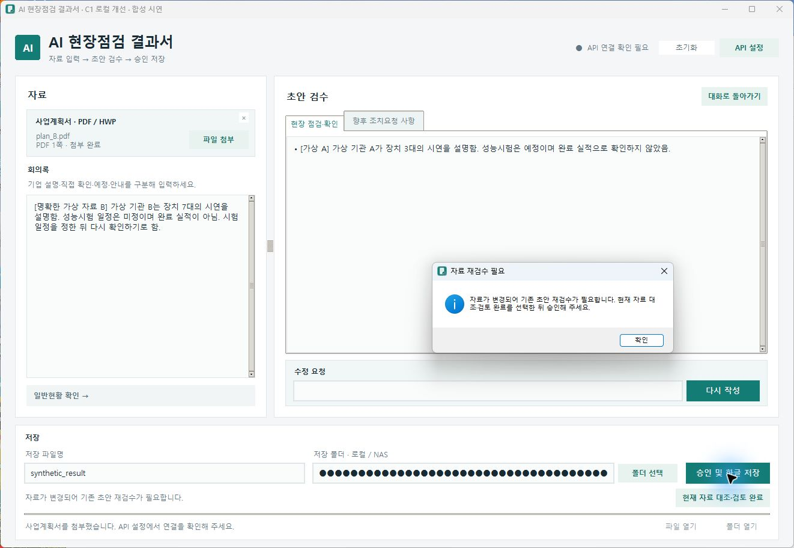

# AI 현장점검 결과서 자동화 | 제품 기획·개발·개선 사례

**AI바우처 현장점검 담당자의 반복적인 결과서 작성을 줄이기 위해 직접 기획한 Windows 제품입니다.** 업무 흐름을 MVP로 만들고, 실제 업무 적용과 사용자 피드백을 바탕으로 검수·입력·편집·저장 경험을 개선해 **v0.4.28 정식 배포**까지 진행했습니다.

**핵심 결과:** 작성시간 평균 약 **60분 → 3분(95% 단축)** — 초기 본인 실무 **3건 이상 적용·자체 측정** · [최신 v0.4.28 Release](https://github.com/munwonshin/ai-inspection-report/releases/tag/v0.4.28) · [버전별 개선 이력](docs/CHANGELOG.md)

> **PM 관점에서 보여주려는 경험:** 실무 문제 발견 → 사용자 작업 흐름 정의 → MVP 범위 결정 → 업무 적용 → 피드백·오류 기반 반복 개선 → 품질 검증·배포 → 다음 개선 과제 선정

**최신 개선 · v0.4.28(2026-11-17):** HWP 저장 기본120초 제한·작업 소유 프로세스 정리·실패 후 편집 보존/재시도, PDF 공개 API 대체, UI 비동기·승인 저장 모듈 분리. 단위 **163/163**, 수용 **28/28**, GUI QA **4/4**, 실제 EXE **10분기·HWP6개 재열기**를 확인했습니다. [새 버전 검증·한계](docs/product/V028_QUALITY_REVIEW.md) · [저장·복구 안내](docs/SAVE_JOB_RECOVERY.md)

## 1. 프로젝트 개요와 나의 역할

| 구분 | 내용 |
| --- | --- |
| **문제·대상 사용자** | AI바우처 사업계획서·회의록을 확인해 결과서를 작성·검수하는 담당자. 특정 사업의 양식·승인 절차를 다루므로 사용자 범위가 한정된 업무용 제품 |
| **제품** | PDF·HWP 사업계획서와 회의록 입력 → AI 초안 → 사람의 검토·직접 편집·채팅 수정 → 승인 → 기존 HWP 양식 저장 |
| **기획·운영 관점 역할** | 반복 업무와 사용자 흐름 분석, MVP 범위 결정, 기능 개선 및 우선순위 판단, 검수·수용 기준 정의, 테스트·배포 결과 확인 |
| **진행 방식** | 1인 업무 개선 프로젝트로 **Codex 등 AI 도구를 활용해 분석·구현·테스트**를 진행. 별도의 개발·디자인팀을 리딩한 프로젝트는 아님 |

## 2. 왜 만들었고, 무엇을 먼저 해결했나

현장점검 후 사업계획서와 회의록을 다시 확인하고, 필요한 내용을 기존 한글 결과서 양식으로 옮기는 데 **건당 평균 약 60분**이 소요됐다. 초안을 자동 생성하더라도 검토·수정이나 HWP 저장이 분리돼 있으면 반복 작업이 남는다.

따라서 **AI가 초안을 작성하고 사람이 검토·수정한 뒤 최종 승인해야 저장하는 하나의 업무 흐름**을 첫 제품 범위로 정했다. 최종 산출물을 새 포맷으로 바꾸기보다 업무에서 사용하는 **기존 HWP 양식을 유지**한 것도 도입 부담을 줄이기 위한 선택이었다.

**초기 업무 적용 결과:** 평균 작성시간 약 **60분→3분**을 확인했다(본인 실무 3건 이상·자체 측정). 기존 HWP 양식과 사람의 검수·승인 절차를 유지해 적용한 결과이며, 이후 C1의 오류 시나리오 시험 수치와 구분한다.

## 3. MVP에서 실제 제품으로 발전시킨 과정

| 단계 | 발견한 문제·개선 필요 | 선택한 제품 변화 |
| --- | --- | --- |
| **초기 MVP · v0.1~0.2** | 자료 확인부터 결과서 작성·승인까지 이어지는 반복 업무 | PDF·회의록 입력, AI 초안, 사람 검수·수정, HWP 저장. 모델·비용 비교 및 전송 중복 개선 |
| **검수 흐름 개선 · v0.3~0.4.0** | 초안을 확인하고 필요한 내용을 다시 고치는 과정의 불편 | 채팅 중심 수정, 직접 편집, 일반현황 자동 입력, PDF 첨부·해제, 회의록 중심 작성 |
| **사용자 피드백·편집 보완 · v0.4.1~0.4.15** | 날짜 입력 불편, 초안 복원·부분 수정 시 편집 내용 보존 필요 | 달력 선택, 점검 정보 고정, 작업 흐름 단순화, 직접 편집 보존·이전 초안 복원 |
| **자료·배포·저장 안정성 · v0.4.16~0.4.26** | PDF 외 자료 지원, 설정·초기화, 설치와 결과 파일 안전성 개선 | HWP 첨부·본문/표 직접 읽기, 작업 초기화, 바로가기·배포 패키지, 저장 임시파일 처리 보완 |
| **최종 승인 품질 개선 · v0.4.27** | 자료 변경 후 이전 본문이 재검토 없이 승인될 수 있는 위험 | **C1 재검수**: 편집물은 보존하고 현재 자료를 검토하기 전 저장 차단. 실제 EXE 검증 후 정식 출시 |

이 표는 실제 [버전별 개선 이력](docs/CHANGELOG.md)을 제품 변화 관점에서 묶은 것이다. 각 버전에서 정식 사용자 조사나 다직군 스프린트가 진행됐다는 의미는 아니다.

### 실제 피드백이 기능 변경으로 이어진 사례

동료에게서 **날짜 입력이 불편하다**는 의견을 듣고 방문일 **달력 선택 기능**을 추가했다(v0.4.8~0.4.11). 또한 편집 흐름에서는 채팅 수정과 이전 초안 복원 기능을 보강했다. 구체적인 업무 불편을 입력 기능 개선으로 연결한 사례이며, 작성시간 단축 수치와는 별도의 피드백 근거로 제시한다.

[상세 개발·검증 기록](docs/DEVELOPMENT_TEST_RECORD_PUBLIC.md) · [사용 방법과 화면](docs/USAGE.md)

## 4. 마지막 개선 사례 — C1 승인 품질

제품이 발전하면서 **자료 A의 본문을 편집한 뒤 자료 B를 첨부해도, 이전 내용이 재검토 없이 승인될 수 있는 보호 공백**을 코드와 합성 시험에서 확인했다. 실제 제출 사고 발생률을 측정한 것은 아니다.

이때 자료가 바뀔 때마다 본문을 삭제하면 사용자의 작업물이 사라지므로, **기존 편집 내용을 보존하면서 새 자료에 대한 명시적 검토 전에는 저장을 차단**하는 방식을 선택했다.

| 개선 후보 | 판단 |
| --- | --- |
| **C1 자료 변경 후 재검수** | 승인 위험을 재현했고 기능 범위를 한정해 오류 차단과 정상 흐름 보존을 함께 시험할 수 있어 먼저 구현 |
| C3 AI 수정 차이 확인 | 기존 초안 복원 기능을 고려해 후속 과제로 분리 |
| C2 HWP 저장 복구 | 실제 장애 빈도와 COM·파일 보호의 복구 위험을 더 확인한 뒤 결정 |

*개인정보 없는 합성 자료·고정 AI 응답으로 실행한 로컬 UI 시연. 이미지 자체는 배포 EXE나 실사용 업무 결과 화면이 아니다.* [전체 화면 흐름](docs/product/C1_DEMO.md)

**기획 → 구현 → 출시 근거:** C1의 목표·MVP·5개 User Story·수용 기준 14개를 정의한 뒤, 합성 시나리오 48회에서 **미검토 저장 진입 18/18 → 0/18**, **정상 저장 오차단 0/30 유지**를 확인했다. 추가로 수용 **26/26**, 기존 단위 **151/151**, GUI QA **4/4** 및 실제 Windows EXE의 HWP 저장·재열기·서식·장문 검증을 거쳐 **2026-11-16 v0.4.27을 정식 배포**했다. 합성 지표는 실제 운영 사고 감소율이 아니다.

[**C1 상세 PM 사례 연구**](docs/product/PM_CASE_STUDY.md) · [PRD·우선순위·수용 기준](docs/product/PRD_PUBLIC.md) · [배포 검증 기록](docs/product/EXE_RELEASE_REVIEW.md)

## 5. 제품을 개선하며 배운 점과 다음 단계

- **업무 전체 흐름을 해결하는 것이 중요했다.** AI 초안만 생성하는 것보다 기존 문서를 입력하고, 사람이 검수·수정해 HWP로 확정하는 과정까지 연결해야 반복 업무를 줄일 수 있었다.
- **실제 피드백과 기존 동작 보존이 개선 기준이 됐다.** 날짜 입력, 수정·복원, 자료 지원과 저장 안전성을 개선하면서 기존 작업물이 사라지거나 정상 흐름이 막히지 않도록 확인했다.
- **출시 이후 확인할 지표를 정했다.** v0.4.27의 기능·배포 검증을 마쳤고, 다음 단계에서는 현장점검 실무자가 재검수 안내를 이해하고 업무를 완료하는지, 검수에 얼마나 시간이 추가되는지 관찰할 계획이다. 실제 사고 감소 효과는 운영 사례가 확보되면 별도로 평가한다. [측정 계획](docs/product/USABILITY_KPI_PLAN.md)

**제품 로드맵:** Released · C1(v0.4.27)·저장 제한/재시도 및 PDF 보강(v0.4.28) → Now · 사용성·지원 환경 검증 → Next 후보 · C3 수정 비교 → Later 후보 · C2 복구 범위 확장. Next/Later는 확정 일정이 아니며 실제 사용·장애 근거에 따라 다시 판단한다.

[시각적 제품 로드맵·리스크](docs/product/ROADMAP_PUBLIC.md) · [사용자 조사·KPI 계획(미실행)](docs/product/USABILITY_KPI_PLAN.md)

상세 문서 및 설치·개발 안내

**전체 제품:** [버전별 개선 이력](docs/CHANGELOG.md) · [개발·검증 기록](docs/DEVELOPMENT_TEST_RECORD_PUBLIC.md) · [사용·설치 안내](docs/USAGE.md)

**최신 개선 심화 자료:** [PM 사례 연구](docs/product/PM_CASE_STUDY.md) · [PRD](docs/product/PRD_PUBLIC.md) · [의사결정 기록](docs/product/DECISION_LOG_PUBLIC.md) · [UX 화면 명세(별도 Figma 미제작)](docs/product/UX_PROTOTYPE_SPEC.md) · [사용자 여정·조사 설계(인터뷰 미실행)](docs/product/USER_RESEARCH_JOURNEY.md) · [실제 HWP E2E](docs/product/C1_E2E_REVIEW.md)

**Windows 설치:** [v0.4.28 다운로드](https://github.com/munwonshin/ai-inspection-report/releases/download/v0.4.28/AIInspectionReport-0.4.28-windows-x64.zip) · [Release·체크섬](https://github.com/munwonshin/ai-inspection-report/releases/tag/v0.4.28) · [이전 v0.4.27](https://github.com/munwonshin/ai-inspection-report/releases/tag/v0.4.27) · [v0.4.26](https://github.com/munwonshin/ai-inspection-report/releases/tag/v0.4.26)

Windows 64비트, 한글 COM 지원 한컴오피스, OpenAI API 키·인터넷 연결이 필요하다. ZIP 전체를 압축 해제하고 `AIInspectionReport` 폴더의 **바탕화면 아이콘 만들기.cmd**를 실행한다. Python 별도 설치는 필요 없다. 실제 업무 문서가 OpenAI API에 전송되며 비용이 발생할 수 있으므로 자료 취급 기준을 준수하고 결과를 사람이 최종 검수해야 한다.

**검증 범위:** 다중 한글 버전·기존 사용자 한글 세션 공존·NAS·강제 COM 중단 복구와 C1 출시 후 사용자 행동 성과는 별도 미검증이다. 해당 부분을 완료 결과로 주장하지 않는다.

