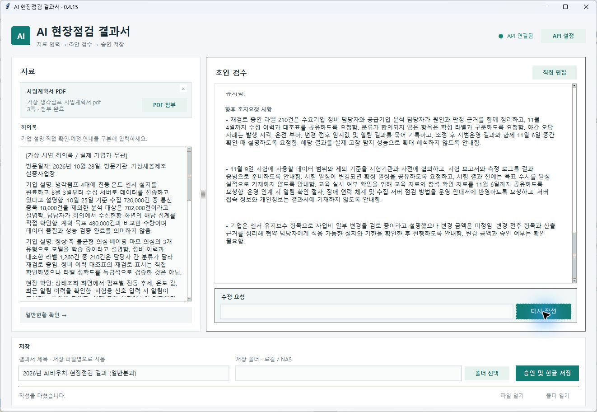

# AI 현장점검 결과서 작성 도구

사업계획서와 회의록으로 AI 초안을 만들고, 검토·수정·승인한 내용을 기존 한글 양식에 저장하는 Windows 프로그램입니다.

**최신 버전 0.4.26** · 자료 입력 → AI 초안 → 검토·채팅 수정 → 승인 후 HWP 저장

## 다운로드

**[Windows 실행용 ZIP 다운로드](https://github.com/munwonshin/ai-inspection-report/releases/download/v0.4.26/AIInspectionReport-0.4.26-windows-x64.zip)** · [전체 배포본](https://github.com/munwonshin/ai-inspection-report/releases)

1. ZIP **전체 압축을 해제**합니다.
2. `AIInspectionReport` 폴더의 **바탕화면 아이콘 만들기.cmd**를 실행합니다.
3. 바탕화면 아이콘으로 프로그램을 엽니다.

**Code → Download ZIP과 Source code (zip)은 개발용 소스입니다.** 설치하려면 위 실행용 ZIP을 받으세요. Python 별도 설치는 필요하지 않습니다.

## 개발 배경

현장점검 후 자료 확인과 결과서 작성에 드는 반복 업무를 줄이기 위해 개발했습니다. 사업계획서는 배경·목표, 회의록은 진행상황과 안내·요청의 근거로 사용합니다.

## 작동 화면



*가상 자료를 사용한 0.4.15 화면입니다. 실제 기업정보·API 키는 포함하지 않았습니다.*

## 주요 기능

| 단계 | 기능 |
| --- | --- |
| 자료 입력 | PDF·HWP 첨부·드래그·삭제, 회의록 입력, 일반현황·연도·분과 자동 분석 |
| 초안 생성 | 회의록 중심 작성, 문맥이 명확한 오타 정리, 생성 진행 표시 |
| 검토·수정 | 직접 편집, 원본·현재 초안을 반영한 채팅 수정, 이전 초안 복원 |
| 승인·저장 | 기존 표·서식에 HWP 저장, 파일·폴더 열기, 덮어쓰기 방지 |

달력·오늘 날짜 표시, 점검자 소속·이름 고정, API 설정을 유지하는 작업 초기화를 지원합니다. 종합의견은 본문 10pt·문단 사이 빈 줄 3pt로 저장합니다.

## 수행 역할 및 적용 결과

업무 문제·기능·사용 흐름 정의와 결과 검수·개선 요청을 맡았습니다. 구현·기술 분석·테스트·빌드는 Codex의 지원으로 진행했습니다. 동료 의견으로 달력을 추가하고 입력이 편리해졌다는 피드백을 받았습니다.

**직접 3건 이상 활용**한 초기 경험에서 입력·생성·검토·수정·최종 저장까지 **평균 약 3분**이 소요됐습니다. 기존 약 1시간 대비 **약 95% 단축**한 개인 경험이며, 건별 측정 기록은 보관하지 않았습니다. 모든 업무에 일반화할 수 없고 동료의 효과는 추가 검증 예정입니다.

[가상 자료 자동 처리시간 시험](docs/WORKFLOW_TIMING_VERIFICATION.md)은 위 실제 적용 경험과 별도 측정입니다.

## 실행 환경 및 사용 방법

**Windows 64비트 · 한글 COM 자동화를 지원하는 한컴오피스 · OpenAI API 키 · 인터넷 연결**이 필요합니다.

1. **API 설정**에서 본인의 키를 저장하고 연결을 확인합니다. 기본 모델은 `gpt-6-luna`입니다.
2. 사업계획서와 회의록을 넣고 자동 입력된 일반현황·연도·분과를 확인합니다.
3. 초안을 생성하고 직접 편집하거나 채팅으로 수정합니다.
4. 파일명·저장 경로를 설정하고 **승인 및 한글 저장**을 누릅니다.

HWP는 한글 실행·PDF 변환 없이 직접 읽습니다(최대 30MB, HWPX 미지원). 로컬·UNC·매핑 드라이브에 저장할 수 있습니다. [첨부 지원 범위](docs/HWP_NO_LAUNCH_VERIFICATION.md)

### API·저장 안내

- 문서·참조 그림·회의록·현재 초안 등이 OpenAI로 전송되며 API 비용은 별도입니다.
- 키는 Windows 자격 증명 저장소에 보관해 재사용하며, 소스·배포 파일에는 포함하지 않습니다.
- 승인 전이나 채팅 수정 중에는 결과 HWP를 저장하지 않습니다. 실패 시 입력은 유지하지만 종료하면 미저장 초안은 사라집니다.
- 사실·수치·자동 입력값은 사용자가 최종 확인합니다. 초기화는 원본·저장 결과서를 삭제하지 않습니다.

<details>
<summary>개발자용 소스 실행·빌드</summary>

Windows용 Python 3.12 64비트에서 실행합니다.

```powershell
python -m venv .venv
.\.venv\Scripts\python.exe -m pip install -r requirements.txt
.\.venv\Scripts\python.exe main.py
```

검사와 패키징은 `.\build.ps1`로 실행하며, 결과는 `dist/AIInspectionReport/`에 생성됩니다. [검사 도구](qa/README.md)

</details>

## 버전별 개선 이력

<details>
<summary>초기 MVP부터 0.4.26까지 보기</summary>

개발·배포 기록에서 확인되는 버전의 주요 변경만 정리했습니다. 과거 버전의 동작이며, 현재 사용 방법은 위 안내를 따릅니다.

| 버전 | 주요 개선 |
| --- | --- |
| 0.1 | PDF·회의록 입력, AI 초안·직접 편집·채팅 수정·승인 후 HWP 저장 구현 |
| 0.2 | 모델·비용 비교, 전송 중복 축소, 기본 모델 선정 |
| 0.3 | 초안 검수를 AI 채팅 중심 화면으로 변경 |
| 0.3.1 | PDF 드래그 앤 드롭 첨부 추가 |
| 0.3.2 | 첨부 삭제(×)·재첨부 추가 |
| 0.3.3 | PDF 읽기 속도 개선·쪽별 진행 표시 |
| 0.3.4 | 생성 경과 시간·점진적 텍스트 표시·파일명 허용 문자 처리 개선 |
| 0.3.5 | 파일명 앞뒤 공백·끝 마침표 자동 정리 |
| 0.3.7 | 일반현황 자동 입력·명사형 보고서 문체 통합 |
| 0.3.8 | 사업계획서 PDF 전체를 통한 일반현황 분석 |
| 0.3.9 | 배포 용량·채팅 화면 갱신 처리 경량화 |
| 0.4.0 | 회의록 중심 작성 강화·향후 조치요청 본문 통합 |
| 0.4.1 | 저장된 API 키 재사용·시작 시 자동 연결 |
| 0.4.2 | 파일 접근 확인 창 없는 HWP 저장·문단 간 빈 줄 3pt 적용 |
| 0.4.3 | 메인 화면 디자인·버튼 배치 정리 |
| 0.4.4 | 초안 작성→수정→승인 작업 흐름 간소화 |
| 0.4.5 | 문맥 기반 오타 해석·본문 분량 균형 지침 개선 |
| 0.4.6 | 불필요한 상태·내부 프롬프트 노출 축소·로딩 표시 개선 |
| 0.4.7 | AI 응답 형식 검증·오류 시 입력 보존 강화 |
| 0.4.8 | 방문일 달력·점검 정보 고정 추가 |
| 0.4.9 | 새 창 대신 앱 내부에 달력 표시 |
| 0.4.10 | 고정 선택을 체크 표시로 개선 |
| 0.4.11 | 오늘 날짜 파란색 표시·날짜 변경 반영 |
| 0.4.12 | 배포 EXE의 API 연결 오류 수정 |
| 0.4.13 | 분과별 제목·한글 날짜 표기·점검자 소속과 이름만 고정 |
| 0.4.14 | 종합의견 본문 10pt 고정·문장 사이 빈 줄 서식 통일 |
| 0.4.15 | 부분 수정 시 직접 편집 보존·이전 초안 정확 복원 |
| 0.4.16 | HWP 사업계획서 첨부 추가(초기에는 PDF 변환 방식) |
| 0.4.17 | ‘별첨2’ 머리글 제거·문서 제목과 저장 파일명 분리 |
| 0.4.18 | API 설정을 유지하는 작업 초기화 추가 |
| 0.4.19 | HWP 본문·표 직접 읽기 추가(복잡한 문서는 변환 병행) |
| 0.4.20 | HWP 첨부 시 한글 자동 실행·자동 PDF 변환 제거, 그림·수식 처리 보완 |
| 0.4.21 | 바탕화면 아이콘 생성·사용자별 프로그램 설치 추가 |
| 0.4.22 | 큰 그림이 포함된 HWP 처리·PDF 오류 대응 보완 |
| 0.4.23 | 근거가 충분한 종합의견 상세화·짧은 메모의 분량 부풀리기 방지 |
| 0.4.24 | 바로가기 설치 보완·소스 ZIP 안내·GitHub 실행용 ZIP 배포 |
| 0.4.25 | EXE 실행에 의존하지 않는 바로가기 설치·한글 경로 호환 보완 |
| 0.4.26 | 저장 중 임시 폴더 표시 제거·숨김 임시파일로 검증 후 HWP 저장 |

[상세 개발·검증 기록](docs/DEVELOPMENT_TEST_RECORD.md) · [검증 문서 안내](docs/README.md) · [전체 커밋 이력](https://github.com/munwonshin/ai-inspection-report/commits/main/)

</details>

## 검증 결과 및 적용 범위

0.4.26은 **단위 검사 151개**와 Windows 빌드·배포 검사를 통과했습니다. 실제 설치·가상 HWP 저장·한글 재입력과 임시 폴더 미생성을 확인했습니다. 검사 건수는 정확도·만족도 수치가 아닙니다.

AI 생성·수정 전체 흐름의 가상 시험은 0.4.23 기록입니다. 다른 PC·한글 버전과 실제 NAS는 추가 검증이 필요합니다.

[검증 문서](docs/README.md) · [모델 비교](docs/MODEL_EVALUATION.md) · [개발 기록](docs/DEVELOPMENT_TEST_RECORD.md) · [제3자 소프트웨어 고지](THIRD_PARTY_NOTICES.md)
