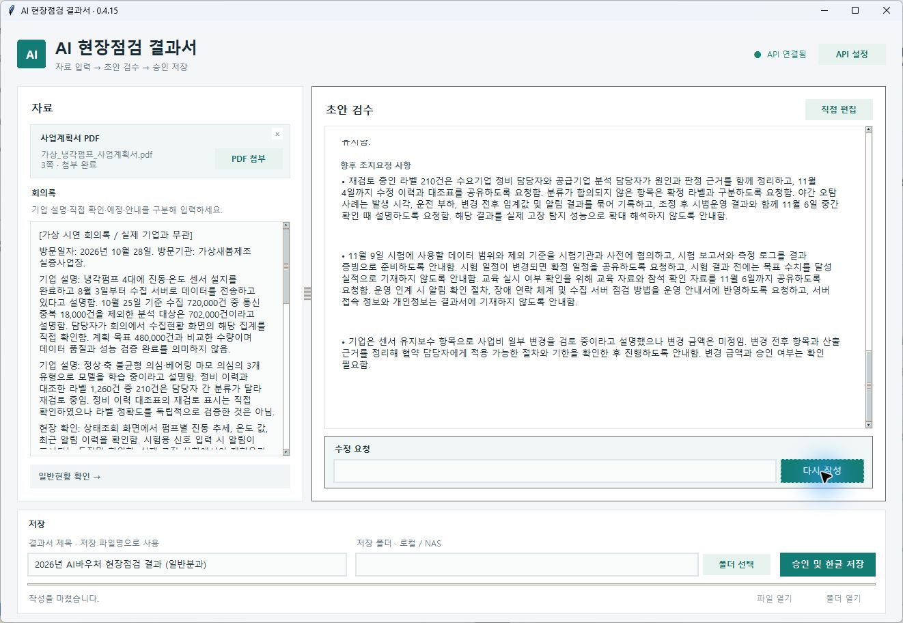

# 설치 이후 사용·개발 안내

이 문서는 기존 main의 **v0.4.26 프로그램** 안내입니다. C1 재검수 개선은 로컬에서 검증한 미출시 기능이며 기존 실행용 ZIP에 포함되지 않았습니다.

## 다운로드·설치

실행용 ZIP 링크와 설치 절차는 [README의 설치·개발 안내](../README.md#설치개발-안내)로 통합했습니다. ZIP 전체를 압축 해제해야 하며 개발용 소스 ZIP과 구분합니다. 실행용 배포본은 Python 별도 설치가 필요 없습니다.

## 기존 v0.4.26 주요 기능

| 단계 | 기능 |
| --- | --- |
| 자료 입력 | PDF·HWP 첨부, 회의록 입력, 일반현황·사업연도·분과 분석 |
| 초안 생성 | 회의록을 근거로 본문 작성, 생성 진행 표시 |
| 검토·수정 | 직접 편집, 채팅 수정, 이전 초안 복원 |
| 승인·저장 | 기존 HWP 양식 저장, 덮어쓰기 방지, 파일·폴더 열기 |

방문일 달력, 점검 정보 고정, API 설정을 유지하는 초기화를 지원합니다. 종합의견은 본문 10pt·문단 사이 빈 줄 3pt로 저장합니다.

<details>
<summary>기존 v0.4.15 가상 시연 화면</summary>



*C1 개선 화면과 다른 과거 버전의 가상 시연입니다.*

</details>

## 사용 방법

**필수 환경:** Windows 64비트, 한글 COM 자동화를 지원하는 한컴오피스, OpenAI API 키, 인터넷 연결

1. **API 설정**에서 키를 저장하고 연결을 확인합니다.
2. 사업계획서와 회의록을 넣고 일반현황·연도·분과를 확인합니다.
3. 초안을 생성하고 직접 편집하거나 채팅으로 수정합니다.
4. 파일명·저장 폴더를 지정하고 **승인 및 한글 저장**을 누릅니다.

- HWP는 첨부 시 한글 실행·PDF 변환 없이 직접 읽습니다. 최대 30MB이며 HWPX는 지원하지 않습니다.
- 로컬·UNC·매핑 드라이브 저장을 지원합니다.
- 문서·참조 그림·회의록·초안 등이 OpenAI로 전송되며 API 비용은 별도입니다. 기본 모델은 `gpt-6-luna`입니다.
- 키는 Windows 자격 증명 저장소에 보관합니다. 사실·수치·자동 입력값은 사용자가 최종 확인해야 합니다.
- 승인 전에는 결과 HWP를 저장하지 않습니다. 실패 시 입력은 유지하지만, 종료하면 미저장 초안은 사라집니다.

[첨부 지원 범위](HWP_NO_LAUNCH_VERIFICATION.md)

## 소스 실행·개발 환경

Python 3.12·Tkinter 기반입니다. PDF는 pypdf/pypdfium2, HWP 저장은 한글 COM, 패키징은 PyInstaller를 사용합니다. 의존성 버전은 [requirements.txt](../requirements.txt)를 확인하세요.

```powershell
python -m venv .venv
.\.venv\Scripts\python.exe -m pip install -r requirements.txt
.\.venv\Scripts\python.exe main.py
```

검사와 패키징은 `.\build.ps1`로 실행하며, 결과는 `dist/AIInspectionReport/`에 생성됩니다.

모델 설정은 현재 소스의 [inspection/api.py](../inspection/api.py)를 따릅니다.

## 추가 자료

[HWP 첨부 지원 범위](HWP_NO_LAUNCH_VERIFICATION.md) · [검사 도구](../qa/README.md) · [버전 이력](CHANGELOG.md) · [제3자 소프트웨어 고지](../THIRD_PARTY_NOTICES.md)
