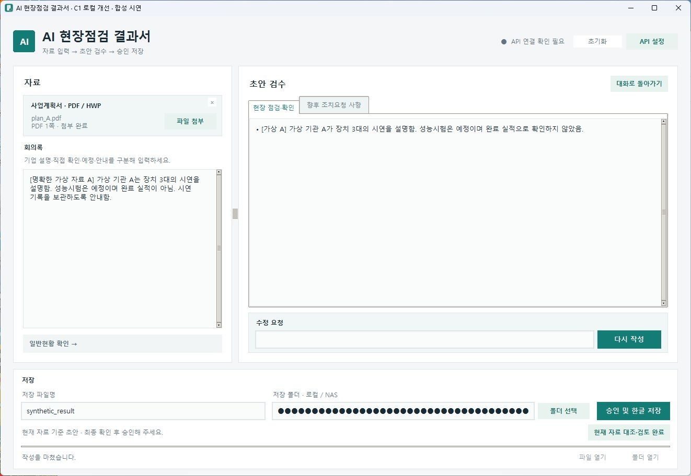
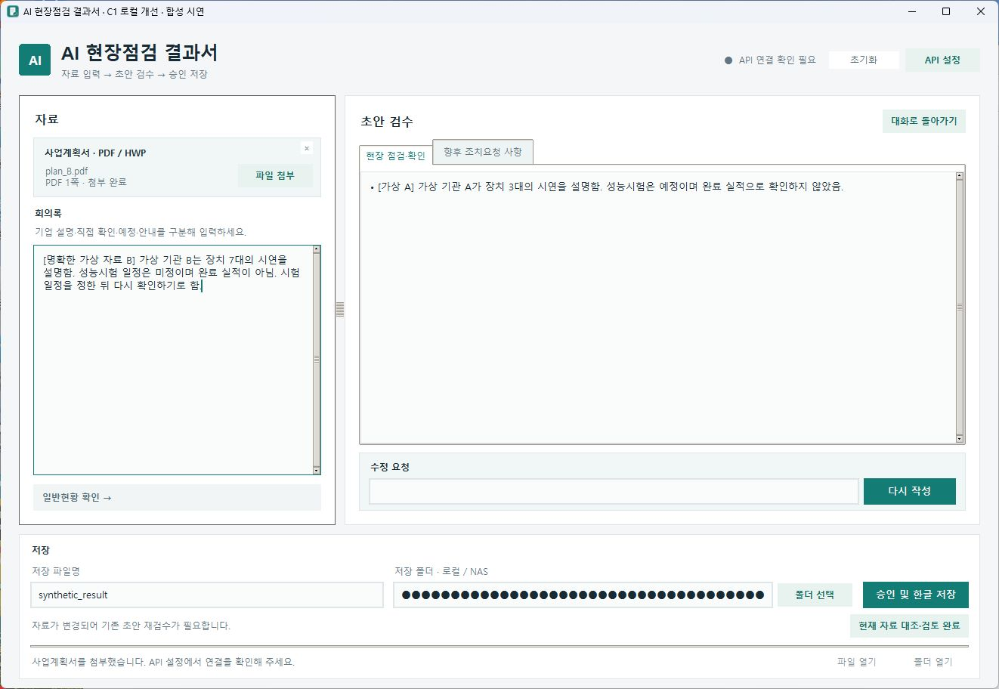
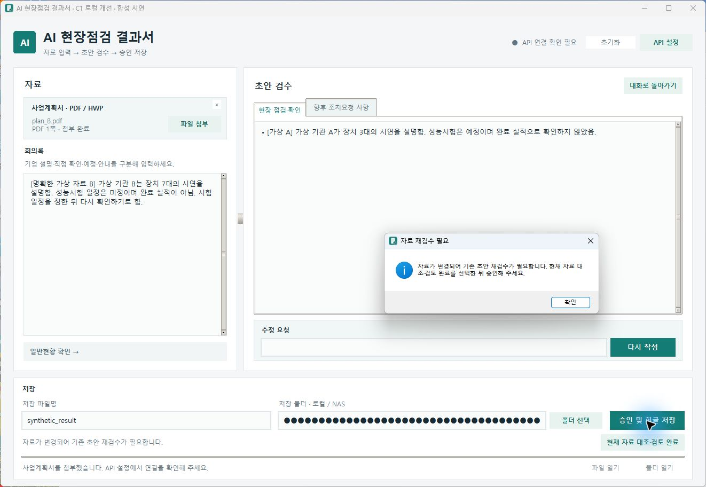
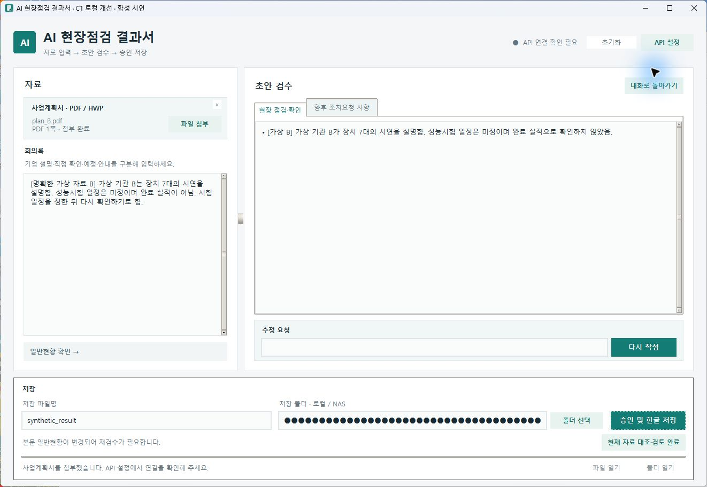
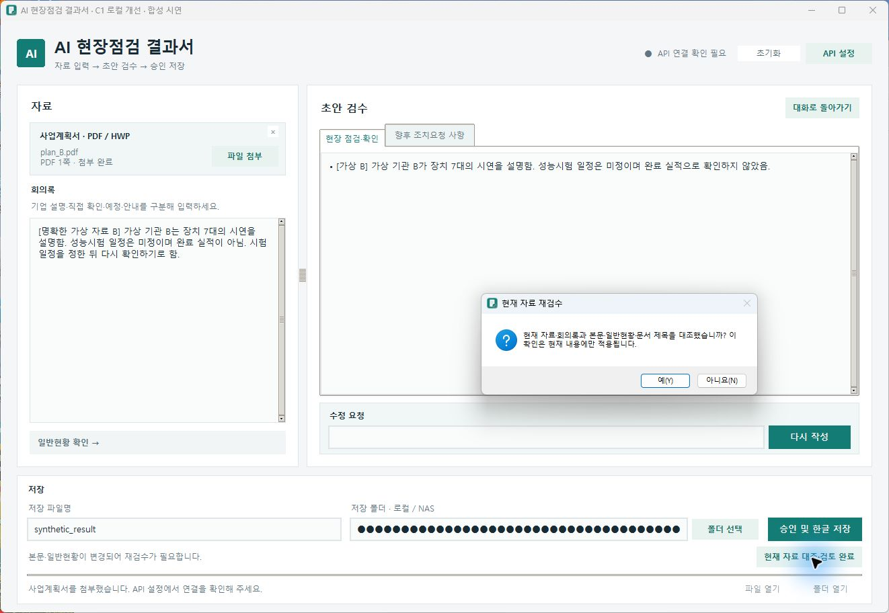
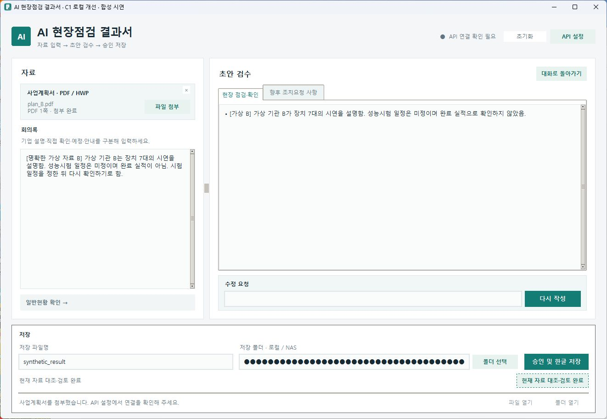

# C1 실제 UI 시연 — 자료 변경부터 명시 검토까지

2026-11-12, 로컬 `codex/c1-source-review`의 실제 Tkinter 창을 실행해 캡처했다. **모든 화면은 C1 로컬 개선 버전이며 main의 v0.4.26 배포본 화면이 아니다.** 기존 v0.4.15 시연과도 구분한다.

## 실행 조건과 관측 범위

- 개인정보 없는 합성 A/B 사업계획서 PDF·회의록·가상 기관/역할만 사용했다. A는 장치3대·시험예정, B는 장치7대·일정미정이다.
- 실제 App의 자료 준비·초안 처리·변경 감지·승인·검토 UI를 호출했다. AI 응답은 고정 합성 응답, 키 접근과 저장은 테스트 대역이다. 내부 검토 허가를 직접 주입하지 않았다.
- 승인 버튼과 검토 대화는 실제 UI에서 조작했다. 네트워크·COM·실제 결과 파일 쓰기는 차단했다.
- 최종 시연에서 실제 API0·COM0·저장 함수 진입0, callback 오류0, 소스 해시 불변을 확인했다. 검토 후 실제 저장은 시도하지 않았다.
- 창 제목에 C1 합성 시연임을 표시하고, 저장 경로는 실제 입력 위젯에서 마스킹했다. 화면 내용·경고를 합성하거나 캡처 뒤 다른 UI로 바꾸지 않았다. 원시 로그·입력 파일은 업로드하지 않는다.

## 1. A 자료로 초안 작성

고정 합성 AI 응답을 실제 초안 생성 처리에 적용했다. 첨부·회의록·본문은 A의 장치3대로 대응하고, 현재 자료 기준 초안임을 표시한다.

## 2. B 자료로 변경 — 기존 본문 유지·재검수 표시

B 자료와 회의록은 장치7대지만, 직접 작성한 내용이 지워지지 않아 오른쪽에는 A의 장치3대 본문이 남아 있다. 하단에 재검수가 필요하다고 표시한다. 연도·분과 등 필수값은 합성 B 기준으로 준비했다.

## 3. 검토하지 않고 승인 — 저장 차단

실제 ‘승인 및 한글 저장’ 버튼을 눌렀다. 다른 필수값 검사 때문이 아니라 ‘자료 재검수 필요’ 안내로 차단됐고 저장 함수에 도달하지 않았다.

## 4. B 자료를 대조해 본문 수정

가상 정답에 따라 본문·일반현황을 B로 수정해 왼쪽 회의록과 오른쪽 본문이 장치7대로 대응한다. 수정만으로 검토가 끝났다고 처리하지 않고 재검수 상태를 유지한다.

## 5. 명시적으로 검토 확인

실제 ‘현재 자료 대조·검토 완료’ 버튼을 누르면 자료·회의록과 본문·일반현황·문서 제목을 대조했는지 확인한다. 이 확인이 현재 내용에만 적용됨을 안내한다.

## 6. 검토 완료 — 저장은 별도 승인

‘예’를 선택한 뒤 ‘현재 자료 대조·검토 완료’ 표시를 확인했다. 여기서 시연을 종료했으며 검토 확인만으로 HWP가 생성되지 않았다.

## 개선 전후를 해석하는 방법

위의 자료 변경 전/후 화면은 **모두 개선된 C1 앱 안의 순서**다. 기존 v0.4.26의 개선 전 UI를 따로 캡처했다고 주장하지 않는다. 개선 전후 성과는 고정 합성 시나리오에서 미검토 진입18/18→0/18·정상 오차단0/30 유지로 비교한다. 이번 1회 시연을 기존48회나 신규25개 검사에 추가하지 않는다.

이는 실제 동작을 설명하는 자료이며 실제 HWP 저장·최종 재열기·C1 정식 배포의 증거가 아니다. 해당 시험은 전용 환경 준비 전 보류다.

[사례 연구](PM_CASE_STUDY.md) · [PRD](PRD_PUBLIC.md) · [로드맵](ROADMAP_PUBLIC.md) · [결정 기록](DECISION_LOG_PUBLIC.md) · [검증 집계](EVIDENCE_SUMMARY.md)
