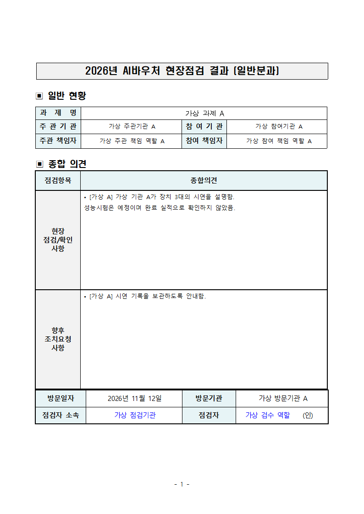
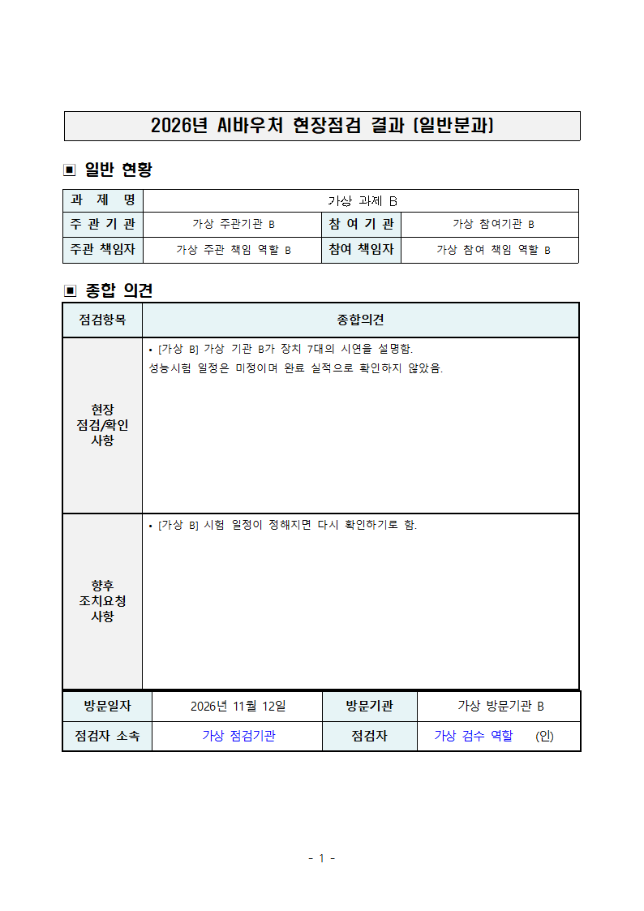
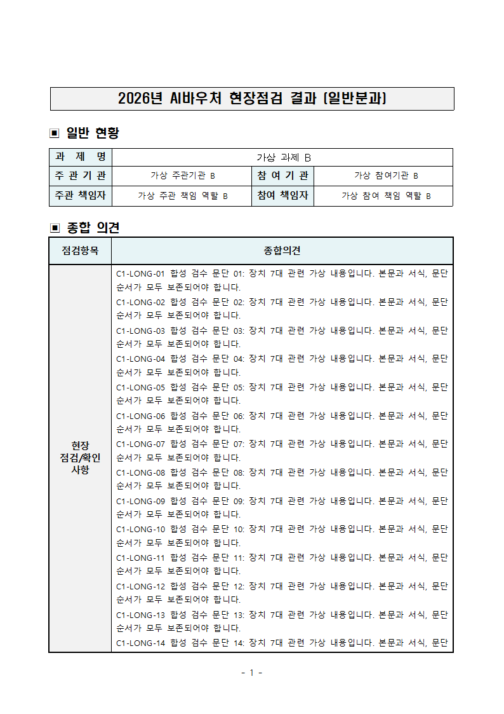
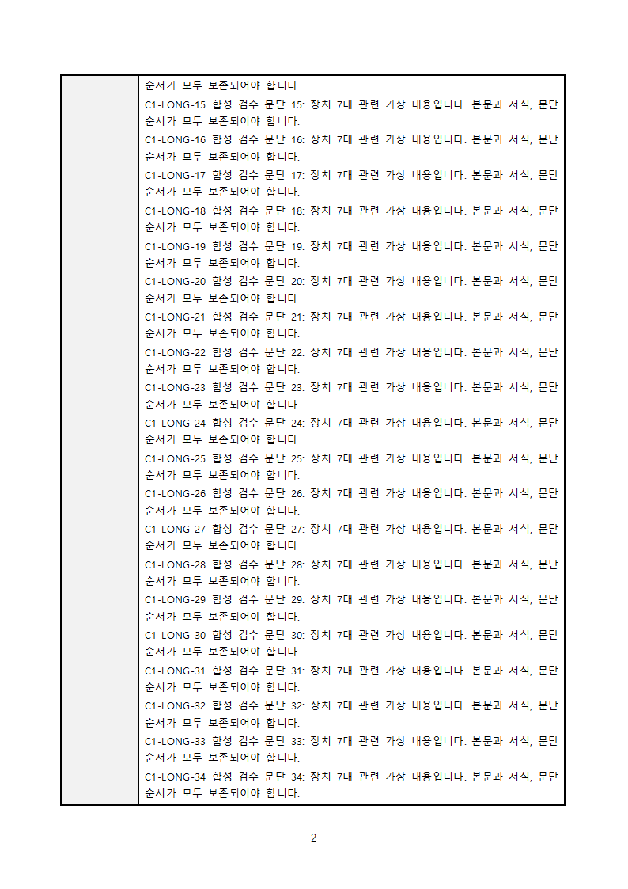
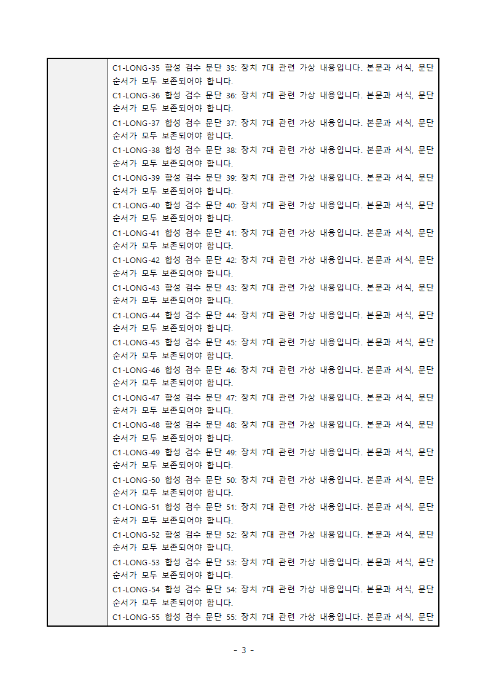
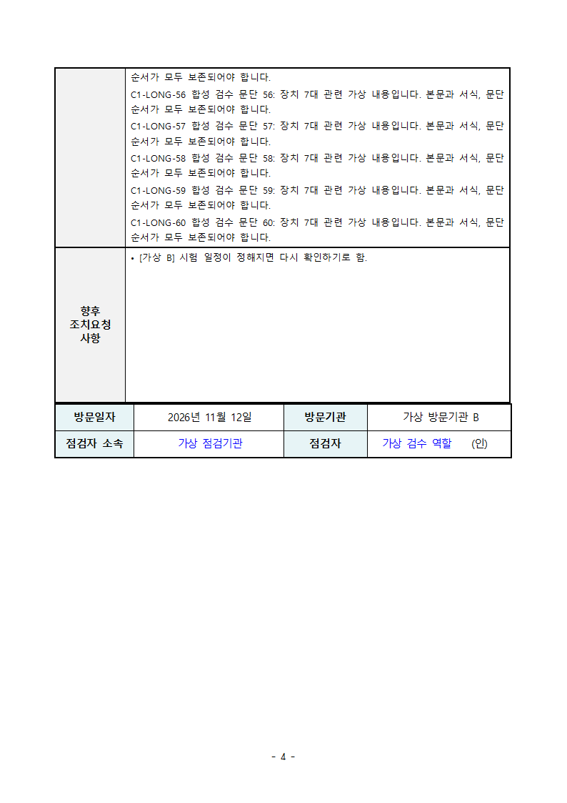

# C1 실제 HWP E2E 결과

2026-11-13 · **지정 범위 PASS / C1 기능 품질 검증 완료** · 배포 EXE·상용 환경 검증과 정식 출시는 별도다.

## 실제 실행한 범위

Windows 11 build 22631, Python 3.12.14 x64, 한글 2018 COM Version 10,0,0,7888에서 합성 자료만 사용했다. 실제 Tk 검토/승인 버튼과 원본 exporter.save→worker→COM을 실행했고, 저장 결과를 별도 COM 재입력 및 실제 파일 Open으로 검증했다. AI 전송·자격증명·테스트 대화상자 응답은 대역이다. 한글 파일 접근 승인은 사용자가 직접 수행했다.

기존 한글이 없는 상태에서 새 HWND/PID 대응을 확인했으며, 시험 소유 세션만 종료했다. 기존 업무 파일·NAS·실제 API 키는 사용하지 않았다. 시험 루트는 새로 만들었고 이전 결과를 덮어쓰지 않았다.

| 사례 | 관측·검증 | 결과 |
| --- | --- | --- |
| A 검토→승인→저장 | 가상 3대·시험 예정. 실제 HWP 생성, 별도 재입력·Open, 승인 내용 대조 | PASS |
| B 변경→미검토 승인 | 이전 A 본문 보존·재검수 안내, exporter/새 HWP 진입 차단, A 해시 불변 | PASS |
| B 재검수→저장 | 7대·일정 미정에 맞춰 편집 후 실제 명시 검토 버튼·승인, 재열기 내용 일치 | PASS |
| 저장 이름 변경 | 내용 검토 유지, 별도 이름으로 B 본문 저장 | PASS |
| 동명 저장 거절 | 이미 존재하는 B 이름 거절, 이전 A/B/변경본 해시 불변 | PASS |
| 장문 60문단 | C1-LONG-01~60, 실제 저장·Open·내용/서식, 모든 4쪽 검수 | PASS |

대상 셀을 승인 Report와 정확히 대조하고 5개 표, 본문 10pt·빈 문단 고정 3pt를 확인했다. 장문은 쪽 경계에서 문장이 이어지며 전체 60개 문단과 마지막 방문/점검자 표가 보존됐다. 실제 한글 렌더 총 7쪽을 검수했고 텍스트 손실·잘림을 관찰하지 않았다.

## 실제 출력 이미지

아래는 실제 생성한 합성 HWP를 한글 CreatePageImage로 렌더링한 것이다. BMP 원본은 로컬 보존했고 공개 PNG는 RGB 픽셀이 일치하는 손실 없는 변환이다. 가상의 UI나 생성형 이미지를 실제 증거로 제시하지 않는다.

### A와 B

### 장문 4쪽 전체

## 후속 재검증과 승인 대기

공개용 체크아웃에서도 실제 UI 버튼을 통한 동일 저장·차단·동명·장문 시나리오를 재실행해 통과했다. 별도 COM 세션 3회에서 4개 최종 파일을 12번 Open해 내용·서식·해시를 확인했다. 최초 43초 및 추가 119.8초 관측에는 사용자 파일 접근 승인 대기가 포함되며, **성능 결함이나 처리속도 개선 수치가 아니다**. 순수 처리시간은 측정하지 않았다.

최초 실행기 오류·중단·감시기 미완료는 로컬에 보존하고 통과 분모에 넣지 않았다. 키트의 사람 수동 확인 서명을 자동으로 꾸며내지 않았으며, 자동화 기능 검사와 사용자 파일 접근 승인이 결합된 실제 COM 검증으로 기록했다.

[최종 품질 판정·미검증 범위](QUALITY_REVIEW.md) · [수용/회귀·실패 기록](EVIDENCE_SUMMARY.md) · [재현 방법](../../qa/c1_native/README.md)
