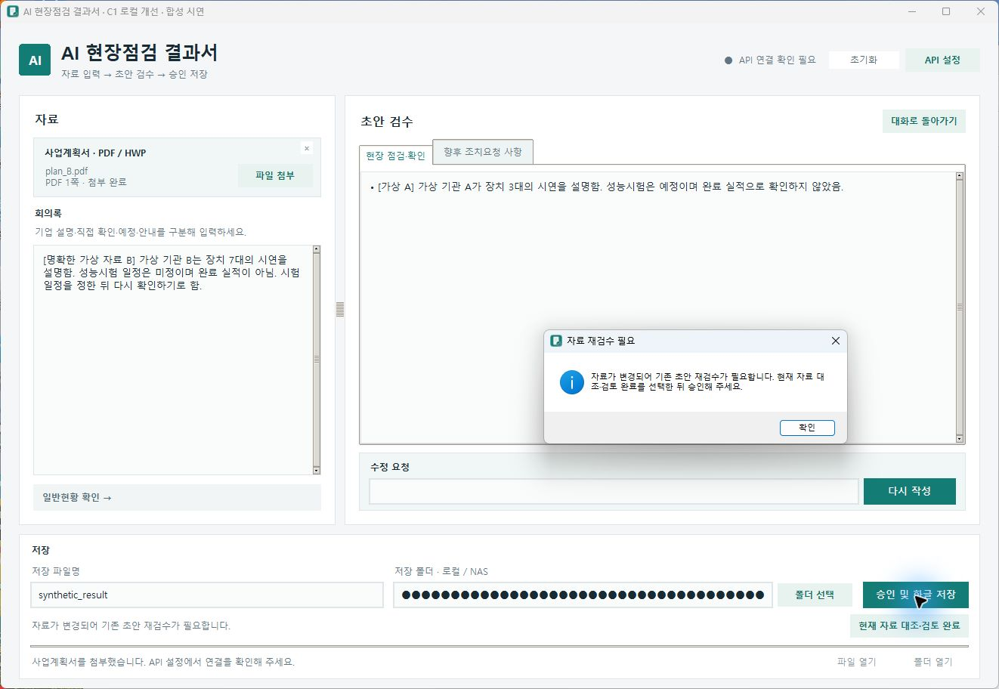

# AI 결과서 자동화에서 승인 품질 개선까지 — PM 사례 연구

> **핵심 성과:** 현장점검 결과서 작성 과정을 자동화해 초기 개인 업무 적용 3건 이상에서 평균 약 **60분→3분(약 95% 단축)**을 경험했다. 이후 자료 변경 시 이전 본문이 재검토 없이 승인될 수 있는 문제를 찾아, **C1 재검수 기능을 우선 선정·기획·구현·검증**했다. 동일 합성 시나리오에서 미검토 저장 진입을 **18/18→0/18건**으로 줄이면서 정상 저장 오차단은 **0/30건**으로 유지했다. 실제 한글(HWP) 저장·재열기 검증까지 통과해 **C1 기능 품질 검증을 완료**했다.

**현재 범위(2026-11-16):** C1 개발·품질 검증에 이어 실제 배포 EXE 핵심 HWP E2E를 통과했고, PR #1을 main에 병합해 **v0.4.27 정식 배포를 완료했다.** 검증한 동일 ZIP을 재빌드 없이 게시하고 공개 다운로드 해시를 확인했다. [배포 근거](EXE_RELEASE_REVIEW.md) 위 시간 단축은 초기 개인 적용 경험으로, C1 출시 이후의 사용자 성과가 아니다.

## 프로젝트에서 내가 맡은 PM 역할

AI데이터사업팀의 현장점검 업무 담당자로서 **업무 문제와 사용 흐름을 정의하고, 개선 과제의 우선순위를 결정하며, MVP 범위·수용 기준·검증 결과를 관리**했다. Codex를 활용해 소스 분석·구현·테스트·문서화 작업을 진행했고, 결과를 확인하며 기능 변경과 품질 판단을 반복했다. 이는 별도 개발 스쿼드나 다수의 개발자를 리딩한 경험이 아니라 **한 명의 실무자가 AI 도구의 도움을 받아 제품을 기획하고 개선한 사례**다.

기존 사용 흐름에서 동료의 날짜 입력 불편 의견을 받아 달력 선택 기능을 반영한 경험이 있다. 다만 **C1 기능에 대한 별도 사용자 인터뷰·사용성 조사나 실제 운영 사고 분석은 수행하지 않았다.** 아래 A/B 자료 예시는 개인정보 없는 합성 시나리오다.

## 기획부터 검증까지의 의사결정 흐름

| 단계 | 확인한 사실과 판단 | 실행·결과 |
| --- | --- | --- |
| **문제 발견** | 결과서 작성에 건당 약 60분이 걸림 | 자료→AI 초안→검수·수정→HWP 저장의 업무 흐름을 MVP로 설계 |
| **초기 검증** | 본인 업무에서 반복 작업을 줄일 수 있는지 확인 | 3건 이상 활용, 평균 약 60분→3분. 건별 원기록·대조군 없음 |
| **추가 문제 발견** | 자료가 바뀌어도 이전 본문이 남아 잘못 승인될 수 있음 | 코드와 합성 자료로 승인 보호 공백 재현. 실제 사고 발생률 미측정 |
| **우선순위 결정** | C1 재검수, C3 수정 차이 확인, C2 저장 복구 중 선택 필요 | 위험도·시급성·개발 부담 비교 후 **C1→C3→C2** 선정 |
| **요구사항 정의** | 단순 경고만으로는 기존 본문 보호·정상 저장 보장 어려움 | 사용자 흐름·MVP 5범위·수용 기준 AC01~AC14 정의 |
| **실행·검증** | 잘못된 승인 차단과 정상 흐름 유지가 동시에 필요 | 합성 48회 통과, 수용 26/26·기존 단위 151/151·GUI 4/4 통과 |
| **품질 판단** | 합성 저장 시험만으로 실제 한글 출력은 보장 불가 | 실제 HWP 4개 생성·재열기·내용/서식 확인. C1 기능 품질 완료, 정식 배포 별도 |

## 1. 반복 작성 문제를 업무 도구로 해결하다

**문제:** 현장점검 후 사업계획서와 회의록을 다시 확인하고, 일반현황과 본문을 한글 양식에 옮기는 데 건당 평균 약 60분이 걸렸다.

**사용자 목표:** 결과서 작성 시간을 줄이되, 업무 담당자가 근거를 확인하고 직접 수정한 후 최종 승인할 수 있어야 한다. 최종 산출물은 기존 양식의 HWP 파일이어야 한다.

**선택한 MVP:** 사업계획서·회의록 입력 → AI 초안 작성 → 직접 편집·채팅 수정 → 사용자 검토·승인 → HWP 저장. 초안 생성만 제공하면 검수와 양식 작성이 별도 도구에 남기 때문에 전체 작업 흐름을 묶었다.

**결과:** 본인 업무 3건 이상에 초기 적용해 평균 작성시간이 약 **60분에서 3분으로 줄었다**고 측정·기록했다. 개인 적용에서 확인한 수치이며 건별 시간 원기록·대조군이 없는 만큼 전체 사용자에게 일반화하거나 C1 자체의 성과로 표현하지 않는다.

## 2. 자동화 이후 새로운 문제를 발견하다

**문제:** A 기업 결과서 작성 중 B 기업의 사업계획서·회의록을 첨부해도 기존 A 본문이 남았다. 편집 내용 보존에는 유리하지만, B 자료와 대조하지 않은 A 본문이 승인·저장 경로에 진입할 수 있었다.

**근거:** v0.4.26의 첨부·해제 흐름은 본문을 유지했고, 승인 흐름은 필수값·제목·저장 경로를 검사했지만 **현재 자료와 본문을 재검토했는지**는 확인하지 않았다. 이 공백은 기존 코드와 합성 자료로 재현했다. 실제 업무에서 서로 다른 기업의 내용이 섞여 제출된 사고를 확인했다는 주장은 아니다. [기존 승인 경계 소스](https://github.com/munwonshin/ai-inspection-report/blob/b48e06a6f87fd0de5f9ff31be5dfcd7a43172fef/inspection/ui.py#L905-L930)

**제품 판단:** 자료를 바꿀 때 본문을 자동 삭제하면 작성자가 편집한 내용을 잃는다. 따라서 **본문은 보존하고, 새 자료를 재검수하기 전에는 저장만 차단**하는 방향을 선택했다.

### 사용자 관점의 개선 전후

| 상황 | 개선 전 | C1 개선 후 |
| --- | --- | --- |
| A 초안 작성 후 B 자료 첨부 | A 본문이 그대로 남음 | 본문은 유지하되 재검수 필요 안내 |
| B 자료 확인 전 승인 | 기존 승인 조건만 충족하면 저장 진입 가능 | 검토 완료 전에는 저장 진입 차단 |
| B 자료와 본문 대조·수정 | 자료 변경에 연결된 검토 상태가 없음 | 현재 자료·본문에 대한 명시적 검토 후 승인 |
| 파일명·저장 폴더만 변경 | 기존 저장 조건 검사 | 내용 검토 상태 유지, 기존 저장 조건 그대로 검사 |

*실제 로컬 C1 화면을 합성 자료와 고정 AI 응답, 저장 대역으로 시연했다. 검토 전 저장 차단 화면이며, 이 캡처 자체가 실제 HWP 저장 검증을 뜻하지는 않는다.* [6단계 화면 시연](C1_DEMO.md) · [실제 HWP E2E 근거](C1_E2E_REVIEW.md)

## 3. 세 가지 개선안을 비교해 C1을 선택하다

**선택 기준:** 영향도(발생 시 결과물과 업무에 미치는 피해), 시급성(재현 근거·우회 수단), 개발 부담(구현·회귀·실환경 검증)을 각각 1~5의 상대 점수로 비교했다. 실제 사고 빈도를 근거로 추정한 ROI나 통계 점수가 아니다.

| 우선순위 | 과제 | 사용자 가치 | 영향도 / 시급성 / 부담 | 판단 |
| --- | --- | --- | --- | --- |
| **1** | **C1 자료 변경 후 재검수** | 잘못된 내용의 승인 방지, 편집 내용 보존 | **5 / 4 / 3** | 승인 보호 공백을 재현했고 제한된 범위에서 검증 가능 |
| 2 | C3 채팅 수정 차이 확인 | AI 수정 결과 검토 부담 감소 | 4 / 3 / 3 | 기존 초안 복원 수단으로 일부 대응 가능 |
| 3 | C2 한글 저장 복구 | 저장 실패·완료 불명 상황의 작업 보호 | 5 / 3 / 5 | 실제 장애 빈도 미확인, COM·프로세스·파일 보호 검증 부담 큼 |

참고 산식 `2×영향도+시급성−개발 부담`에서는 C1=11, C3·C2=8이었다. 동점에서는 1인 개발·검증 가능성을 고려해 C3을 앞에 두었고, 초기 C1→C2→C3 제안을 **C1→C3→C2**로 변경했다. C2와 C3은 별도 후속 과제로 분리했다.

[제품 로드맵: Now/Next/Later](ROADMAP_PUBLIC.md) · [실제 의사결정 기록](DECISION_LOG_PUBLIC.md)

### 검증에 앞서 구분한 사용자 증거

이 프로젝트의 사용자 이해는 **직접 수행한 현장점검 업무**와 **실제로 받은 날짜 입력 피드백**에서 출발했다. C1의 A/B 자료 변경 위험은 코드·합성 사례로 발견했으므로 **사용자 인터뷰나 제출 사고 통계를 확보한 사례는 아니다**. 이를 바탕으로 [사용자 여정 지도](USER_RESEARCH_JOURNEY.md)에 가설을 정리하고, 실제 인터뷰·행동 관찰은 [후속 테스트 계획](USABILITY_KPI_PLAN.md)에 남겼다.

### 제품 목표와 제약을 함께 정의하다

C1은 **업무 운영의 결과서 확정 위험을 줄인다**는 목표와 **작성자는 편집 내용을 잃지 않아야 한다**는 사용자 목표를 함께 다뤘다. 이를 위해 자료를 바꾸면 본문을 자동 삭제하는 방식 대신, 본문은 유지하면서 재검수 전 저장을 차단했다. C1의 Must 범위와 보류 기능, 기존 UI·HWP COM·비동기 처리 제약은 [PRD의 Goals·기능 우선순위·Technical Requirements](PRD_PUBLIC.md)에 정리했다.

이 목표는 제품 기획 방향이지 조직이 확정한 KPI나 실사용 사고 감소를 실측한 결과는 아니다. 결과 검증에서는 **합성 승인 오류 차단**과 **정상 저장 보존**을 함께 측정했다.

## 4. 사용자 경험을 구체적인 요구사항으로 바꾸다

**MVP 목표:** 현재 자료를 확인하지 않은 채 결과서가 확정되는 위험을 막으면서, 기존 편집 내용과 정상적인 저장 흐름은 유지한다.

| MVP 범위 | 사용자 경험 및 완료 조건 |
| --- | --- |
| 자료 식별 | 같은 파일 경로라도 실제 처리한 내용이 달라지면 새 자료로 인식 |
| 변경 안내 | 이전 본문은 보존하면서 재검수가 필요한 이유 표시 |
| 명시 검토 | 현재 자료·본문·일반현황·문서 제목을 대조했다는 확인 필요 |
| 복원·비동기 보호 | 과거 초안 복원·늦게 도착한 AI 응답이 최신 입력과 검토 상태를 덮어쓰지 않음 |
| 승인 전 보호 | 현재 내용의 검토가 유효한 경우에만 기존 저장 절차로 전달 |

**정상 흐름도 함께 지켰다.** 같은 처리 자료의 재첨부나 저장 파일명·폴더만 변경하는 작업은 불필요한 재검수를 요구하지 않고, 본문·일반현황·자료 내용 변경 시에는 검토 상태를 무효화하도록 정했다. 수동 작성·첨부 취소·실패·초안 복원도 예외로 정의했다.

[PRD](PRD_PUBLIC.md)에 **AC01~AC14의 입력 조건·예상 동작·검증 방법**과 추가 분기 X01~X08을 정의했다. 요구사항과 시험 결과를 추적할 수 있도록 했고, 자동 사실 판정·채팅 수정 차이 화면·저장 복구는 C1 범위에서 제외했다. 세부 검사표는 PRD를 참고하면 된다.

## 5. 위험 차단과 정상 동작을 함께 측정하다

잘못된 저장을 모두 차단하더라도 **정상 저장까지 막는다면 제품 개선이라고 보기 어렵다.** 그래서 기존 코드와 C1 코드에서 동일한 입력·시나리오·판정 기준을 사용했다.

| 지표 | 측정 의미 | C1 이전 기준선 | C1 최종 |
| --- | --- | ---: | ---: |
| **미검토 저장 진입** | 재검수 없이 저장 함수에 도달한 시도 | **18/18** | **0/18** |
| **정상 저장 오차단** | 정상인데 저장 함수에 도달하지 못한 시도 | **0/30** | **0/30 유지** |
| 합성 계약 전체 | 16개 고정 시나리오×3회 | 18 실패·30 통과 | **48/48 통과** |

총 48회는 **미검토 6종 + 정상 10종을 각각 3회 반복한 합성 시험**이다. 실제 사용자 48명 또는 운영 사고 48건이 아니다. 이 시험에서는 API·HWP 저장을 대역으로 두고 실제 UI의 승인→저장 함수 진입 경계를 관찰했다. 별도의 실제 HWP E2E 시험과 수치를 합산하지 않았다.

**추가 품질 검증:** 신규 수용 검사 **26/26**, 기존 단위 검사 **151/151(제외 0)**, GUI QA **4/4**를 통과했다. 이전 테스트 실패와 중단 기록은 보존하고, 실제 HWP 연동 결과는 다음 단계에서 별도로 확인했다. [검증 집계와 실패 이력](EVIDENCE_SUMMARY.md)

## 6. 실제 HWP까지 확인하고 품질을 판단하다

**추가 검증 이유:** 합성 시험만으로는 실제 한글 파일이 정상 생성되는지, 다시 열었을 때 내용·표·서식이 유지되는지 확인할 수 없었다.

**수행:** 사용자가 한글 파일 접근 보안 승인을 직접 처리한 환경에서 실제 한글 COM을 사용했다. A/B 자료 및 파일명 변경·장문 사례에 대한 **HWP 4개**를 생성했고, 기존 동명 파일 보호와 재열기·내용·서식을 검증했다. 별도의 새 COM 세션에서 **4개 파일×3회=12회 추가 Open**을 확인했으며, 장문 4쪽을 포함해 **전체 7쪽**의 실제 한글 렌더 결과를 검토했다.

**발견한 오류와 대응:** 첫 저장 성공 후 동일 이름으로 재저장에 실패해도 이전 성공 표시가 남는 문제를 발견했다. 실패 상황을 테스트로 재현한 뒤, 새로운 저장 시도가 시작되면 성공 표시와 파일 열기 버튼을 초기화하도록 수정했다. 본문과 마지막 성공 경로는 보존했고, 관련 수용 검사를 추가해 **26개**를 통과했다.

**품질 판정:** 실제 HWP E2E, 합성 계약, 수용·회귀·GUI 검증을 모두 통과해 **정의한 C1 기능 범위의 품질 검증 완료**로 판단했다. 이후 11월 16일 실제 배포 EXE 검증·정식 출시를 완료했다. 상용 환경 전반의 안정성은 별도 미검증이다.

**검증의 한계:** 실제 AI 응답 품질·C1 실사용 검수시간·사용자 만족도·운영 사고율은 미측정이다. COM Open의 43초·119.8초에는 사람의 파일 접근 승인 대기가 포함돼 순수 처리시간이나 성능 결함·개선 수치로 사용하지 않는다. 강제 COM 멈춤 복구는 C2의 별도 범위다.

[실제 HWP 출력 및 E2E](C1_E2E_REVIEW.md) · [최종 품질 검토](QUALITY_REVIEW.md) · [출시 검토](RELEASE_REVIEW_PUBLIC.md)

## 7. 출시 판단과 다음 개선

| 구간 | 다음 과제 | 사용자 가치·완료 판단 | 현재 상태 |
| --- | --- | --- | --- |
| **NOW** | C1 배포 판단과 제한 사용자 관찰 | v0.4.27 배포 완료 후 재검수 안내 이해도·활성 검수시간 관찰 | 소스·실제 EXE 검증 및 정식 배포 완료, 사용자 관찰은 계획 |
| **NEXT** | C3 채팅 수정 차이 확인 | AI 수정 전후 비교·적용/취소와 C1 검토 흐름의 회귀 검증 | 미착수 |
| **LATER** | C2 한글 저장 복구 | 저장 실패·완료 불명 사례 조사 후 안전한 복구 조건 정의 | 미착수 |

사용자 조사나 실운영 위험이 새로 확인되면 **영향도·시급성·검증 부담을 다시 평가**해 순서를 조정할 계획이다. 이 구간은 확정 일정이 아니라 현재의 우선순위다. [제품 로드맵](ROADMAP_PUBLIC.md)

## 8. 이번 프로젝트에서 배운 점

1. **업무 속도만 높여서는 충분하지 않았다.** 반복 작성 시간을 줄인 뒤에도 결과서가 올바르게 승인되는지 별도로 살펴봐야 했다.
2. **모든 기능을 한 번에 만들지 않았다.** 사용자에게 미치는 위험과 한정된 개발·검증 자원을 비교해 C1을 먼저 선택했다.
3. **좋은 기능은 위험 차단과 정상 흐름 유지가 함께 검증돼야 했다.** 미검토 저장 진입과 정상 저장 오차단을 같은 시나리오에서 함께 측정했다.
4. **검증 결과와 출시 상태를 구분했다.** 소스·실제 EXE 검증과 정식 배포를 각각 확인했다. 미실행인 사용자 성과·상용 환경 전반의 검증은 완료로 표현하지 않았다.

이 사례는 **문제 발견 → 사용자 가치 정의 → 우선순위 결정 → PRD·수용 기준 → 구현 → 합성·실연동 검증 → 출시 판단**의 과정을 보여준다. 다수 개발자를 이끈 조직 프로젝트가 아닌 1인 업무 개선 프로젝트이며, 실제 동료 피드백 경험·개인 업무 적용·합성 시험·한글 실연동·향후 기대 효과의 근거 수준을 구분한다.

## 현재 완료한 경험과 남은 학습 과제

| 실제 완료한 일 | 설계·계획만 완료한 일 |
| --- | --- |
| 업무 흐름을 MVP로 기획하고 초기 개인 업무에 적용 | C1 사용자 인터뷰·사용성 테스트 |
| 동료의 날짜 선택 불편을 듣고 기능에 반영 | 정량적인 사용자 만족도·검수시간·퍼널 측정 |
| C1 승인 위험 재현, PRD·수용 기준·우선순위 결정 | Figma 파일·클릭형 프로토타입 제작 |
| 로컬 UI 구현, 합성·실제 HWP·실제 EXE 시험, main 병합·v0.4.27 정식 배포 | 상용 환경 전반·사용자 검수시간 관찰 |

[UX 화면/프로토타입 제작 명세](UX_PROTOTYPE_SPEC.md)와 [요구사항 추적용 백로그](PRODUCT_BACKLOG.md)는 실제 구현 내용을 설명하고 향후 작업을 준비한 문서다. 스쿼드 협업이나 사용자 테스트를 했다는 증거로 해석하지 않는다.

## 근거 문서

[사용자 시나리오·요구사항 PRD](PRD_PUBLIC.md) · [제품 로드맵](ROADMAP_PUBLIC.md) · [의사결정 기록](DECISION_LOG_PUBLIC.md) · [합성·회귀 시험 집계](EVIDENCE_SUMMARY.md) · [실제 UI 시연](C1_DEMO.md) · [실제 HWP E2E](C1_E2E_REVIEW.md) · [품질 판정](QUALITY_REVIEW.md)

개인정보 없는 합성 자료와 공개 가능한 화면·집계·코드만 링크하며, 회사 원자료·원시 HWP·호스트 경로·인증정보는 공개하지 않는다.
