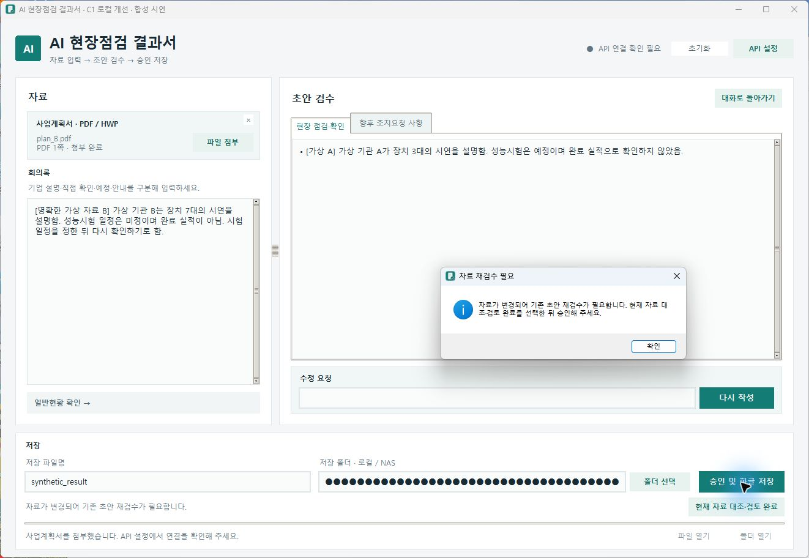

# AI 결과서 자동화에서 승인 품질 개선까지

현장점검 결과서의 반복 작성 업무를 줄인 도구를 바탕으로, **자료 변경 뒤 이전 본문이 저장 경로에 진입하는 보호 공백**을 정의하고 C1 재검수 기능을 개선했다. 같은 합성 시나리오에서 미검토 저장 진입을 **18/18→0/18건**으로 줄였고, 실제 HWP 연동 검증이 남아 정식 출시는 보류했다.

대상: 기존 v0.4.26 및 로컬 C1 개선 버전. C1 합성 결과는 PM 승인, 실제 COM 시험은 전용 환경 준비 전까지 보류 상태다. 아래는 로컬 증거를 정리한 사례이며 사용자 인터뷰·A/B 테스트·대규모 운영 검증 사례가 아니다.

## 역할과 증거의 구분

업무 문제·사용 흐름·개선 우선순위·개발 범위·수용 기준·검수 및 출시 여부를 PM 관점에서 검토·결정했다. Codex의 소스 분석·문서 초안·구현·테스트 지원을 활용했다. 별도 스쿼드나 다수 개발자를 리딩한 경험으로 표현하지 않는다.

| 구분 | 확인된 결과 | 해석 한계 |
| --- | --- | --- |
| 초기 실제 업무 적용 | 본인 3건 이상 활용, 기존 평균 약 60분→도구 사용 후 평균 약 3분, 약 95% 단축 | 초기 개인 적용 경험. 건별 시간 원기록·대조군 없음. C1 효과가 아님 |
| C1 합성 검증 | 미검토 저장 진입 18/18→0/18, 정상 저장 오차단 0/30 유지 | 실제 UI의 저장 함수 진입 경계. API·HWP 저장은 대역 처리 |
| 실제 사용자 검수·출시 | C1 실사용 검수시간·만족도·운영 혼재율 미측정, 정식 출시 보류 | 합성 결과를 운영 사고 감소나 사용자 효과로 환산하지 않음 |

## 실제 C1 화면으로 보는 사용자 흐름

**A 초안 작성 → B 자료로 변경 → A 본문 보존·재검수 표시 → 미검토 승인 차단 → B 내용 대조·수정 → 명시 검토 완료**

아래는 로컬 C1의 실제 창에서 승인 버튼을 눌러 확인한 차단 화면이다. 왼쪽은 B의 장치7대 회의록, 오른쪽은 남아 있는 A의 장치3대 본문이다. 작성 내용은 지우지 않고, 재검토하기 전에는 저장 경로 진입을 차단한다.

[6단계 전체 화면과 실행 조건](C1_DEMO.md)을 확인할 수 있다. 모든 화면은 합성 자료·고정 응답·저장 대역으로 실행한 **C1 로컬 개선 버전**이며, 기존 v0.4.15 화면과 구분한다. 실제 API/COM/저장 함수 진입0회, 소스 불변을 확인했고 검토 후 저장은 실행하지 않았다. 저장 경로는 실제 위젯에서 마스킹했다. 이번 시연을 기존48회/신규25개 검사 분모에 추가하지 않는다.

[독립 공개 PRD](PRD_PUBLIC.md) · [독립 ROADMAP](ROADMAP_PUBLIC.md) · [독립 DECISION_LOG](DECISION_LOG_PUBLIC.md)

## 1. 업무 문제와 초기 MVP

**문제:** 현장점검 후 사업계획서·회의록을 다시 확인하고, 일반현황과 본문을 기존 한글 양식에 옮기는 반복 작업이 있었다. 작성자 본인이 사용하면서 업무 흐름을 구체화했다. 별도의 사용자 인터뷰를 수행한 것으로 기록하지 않는다.

**판단 근거:** 사업계획서는 배경·목표, 회의록은 진행상황·안내·요청의 근거로 쓰였다. 생성 결과는 사람이 확인해야 하고 최종 제출 형식은 HWP였다. 따라서 초안 생성만 제공하면 검수와 양식 작성이 다른 도구에 남는다.

**수행:** 자료 입력 → AI 초안 → 직접 편집/채팅 수정 → 사용자 승인 → 기존 HWP 양식 저장을 MVP로 묶었다. 자동화와 함께 최종 승인·수정 내용 보존·덮어쓰기 방지를 기본 흐름으로 두었다.

**결과:** 초기 실제 업무 3건 이상에서 평균 약 60분→3분, 약 95% 단축을 경험했다. 개인 자기 보고이며 재현 가능한 시간 실험과 구분한다. 현재 소스는 Python/Tkinter 기반 Windows 앱이며 한글 저장에는 COM 자동화가 필요하다.

## 2. 기존 제품의 보호 공백 발견

**문제:** 자료를 바꿔도 이전 본문을 남겨두는 것은 편집 보존에 유용하지만, 새 일반현황과 이전 본문이 함께 승인될 수 있었다.

**판단 근거:** v0.4.26의 `App.load_pdf`·`remove_pdf`는 본문을 유지하고, `approve`는 필수값·제목·경로를 확인하지만 현재 자료와 본문의 연결은 검사하지 않았다. 기존 승인 검사는 “사용자가 승인했는가”, 복원 검사는 “정확히 되돌렸는가”를 확인할 뿐 “지금 자료를 검토했는가”를 보장하지 않았다. 첨부·회의록 변경 뒤 이전 본문이 모의 저장 함수에 전달되는 경로를 가상 자료로 재현했다.

**수행:** README·소스·기존 검사·QA·벤치마크를 대조하고, 구현된 보호와 사용자가 직접 찾아야 하는 오류를 나누었다. 제품 분석에서는 8개 후보를 정리하고 그중 승인·검수·저장 경계에 가까운 C1/C2/C3을 재비교했다.

**결과:** 실제 혼재 사고가 확인됐다는 주장이 아닌, 재현 가능한 보호 공백을 문제로 확정했다. 발생 빈도·사용자 피해·연속 작성 빈도는 미확인으로 남겼다. [제품 분석](PM_CASE_STUDY.md#2-기존-제품의-보호-공백-발견), [기준 v0.4.26 코드의 승인 경계](https://github.com/munwonshin/ai-inspection-report/blob/b48e06a6f87fd0de5f9ff31be5dfcd7a43172fef/inspection/ui.py#L905-L930)

## 3. 세 개선 과제의 우선순위 결정

**문제:** 자료 혼재 예방, 저장 복구, 수정 검수 모두 가치가 있지만 한 번의 MVP에 넣으면 구현과 검증 범위가 커진다.

**판단 기준:** 영향도는 문제 발생 시 결과물·작업에 미치는 피해, 시급성은 확인한 증거와 우회 수단, 개발 부담은 구현부터 회귀·실환경 검증까지의 부담으로 정의했다. 1은 국소 불편/낮은 필요성/국소 변경, 3은 반복 검수/빈도 미확인 위험/UI 상태 검증, 5는 잘못된 결과나 핵심 작업 중단/실제 반복 피해/COM·프로세스·파일 경합 검증이다. 실제 반복 피해가 없어 시급성 5는 부여하지 않았다.

| 과제 | 영향도 | 시급성 | 개발 부담 | 점수 근거 | 순위 |
| --- | ---: | ---: | ---: | --- | ---: |
| C1 자료 변경 후 재검수 | 5 | 4 | 3 | 잘못된 최종 내용 확정 위험, 승인 공백 재현, 상태/UI 중심으로 범위 제한 가능 | 1 |
| C3 채팅 수정 차이 확인 | 4 | 3 | 3 | 의도 밖 변경 검수 부담, 기존 복원으로 일부 회복 가능, 전체 수정안 비교부터 개발 가능 | 2 |
| C2 한글 저장 복구 | 5 | 3 | 5 | 핵심 작업 중단 위험, 실제 빈도 미확인, 완료 불명·프로세스·파일 보호 실연동 부담 | 3 |

**수행:** 참고 산식 `2×영향도+시급성−개발 부담`으로 C1=11, C3=C2=8을 비교했다. 이 값은 ROI나 통계가 아니다. 동점에서는 1인 실행 부담과 검증 가능성을 우선해 C3을 앞에 두었다. 초기 분석의 C1→C2→C3 순서를 재검토해 PM이 C1→C3→C2로 결정했다.

**결과:** C1을 첫 과제로 확정했다. C3의 비교·적용/취소 UI와 C2의 timeout·안전 재시도는 보류했다. 실제 저장 중단이나 수정 손실의 반복 증거가 생기면 순위를 다시 판단한다. [우선순위 비교](ROADMAP_PUBLIC.md), [결정 기록](DECISION_LOG_PUBLIC.md)

## 4. PRD와 14개 수용 기준

**문제:** “변경되면 경고”만 정의하면 정상 재첨부·수동 작성까지 막거나, 부분 수정·복원 후 오래된 검토가 되살아날 수 있다.

**판단:** 자료와 본문의 연결을 현재 상태에 묶되, 입력·편집 보존과 정상 저장 흐름을 유지해야 했다. MVP를 ①처리 자료 식별 ②변경 표시 ③명시 검토 ④복원·비동기 일치 확인 ⑤승인 전 보호로 제한했다.

**수행:** 각 요구의 입력 조건·예상 동작·검증 방법을 PRD에 정의하고 AC01~AC14 및 X8 분기로 연결했다. 같은 처리 자료 재첨부와 파일명/폴더 변경은 검토를 유지하고, 본문·일반현황·문서 제목 변경은 검토를 무효화하도록 구분했다.

| AC | 수용 기준 요약 | 현재 판정 |
| --- | --- | --- |
| 01 | 다른 PDF/HWP 처리 자료 첨부 시 본문 보존·미검토 차단 | 합성 통과, HWP 준비는 대역 |
| 02 | 회의록 내용 변경 후 재검수 | 합성 통과 |
| 03 | 첨부 실패·취소·미지원 입력은 기존 상태 보존 | 합성 통과 |
| 04 | 경로 대신 처리 자료 동일성, 줄바꿈 형식만 동일 취급 | 합성 통과 |
| 05 | 검토 취소 시 허가·저장 없음 | 합성 통과 |
| 06 | 검토한 내용과 승인 시 저장 함수에 전달한 내용 일치 | 합성 통과 |
| 07 | 내용 변경은 검토 무효, 파일명/폴더만 변경은 유지 | 합성 통과 |
| 08 | 부분 수정 성공·거절·오류가 재검수를 해제하지 않음 | 합성 통과 |
| 09 | 과거 본문 복원 후 현재 자료로 다시 검토 | 합성 통과 |
| 10 | 현재 요청과 일치하는 전체 생성의 정상 승인 | 합성 통과 |
| 11 | 수동 작성·필수값 보완 흐름 유지 | 합성 통과 |
| 12 | 자료·본문·초기화 뒤 지연 응답 적용 방지 | 합성 통과 |
| 13 | 초기화 성공/거절/실패·연결 불명 초안 처리 | 합성 통과 |
| 14 | 출력 진입 보호·저장 안전성·편집 보존 | 모의 검증만 완료, 실제 HWP 미검증 |

**결과:** 자동 사실 검증·차이 표시·저장 복구를 추가하지 않고 승인 일관성에 집중했다. [공개 PRD](PRD_PUBLIC.md), [전체 수용 검증표](RELEASE_REVIEW_PUBLIC.md)

## 5. KPI와 합성 기준선 설계

**문제:** 모든 저장을 막아도 미검토 진입은 0이 될 수 있다. 위험 차단만으로는 개선을 판정할 수 없었다.

**판단:** 미검토 진입과 정상 작업 오차단을 함께 측정하고, 실제 HWP 생성과 저장 함수 진입을 분리했다.

| 지표 | 산식·분모 | 성공 기준 |
| --- | --- | --- |
| M01 미검토 저장 진입률 | 미검토인데 저장 함수에 도달한 승인 시도 / 유효 미검토 승인 18회 | 0/18 |
| M02 정상 저장 오차단율 | 정상 조건인데 저장 함수에 도달하지 못한 시도 / 유효 정상 승인 30회 | 0/30 유지 |
| 내용·중복 보조 조건 | 전달한 Report의 정답 일치와 호출 수 | 정상 각 1회, 잘못된 내용·중복 호출 0 |
| M04 활성 검수시간 | 자료 변경 후 대조 시작부터 승인 준비까지, 명시 중단 제외 | 정의만 완료, 미측정 |

**수행:** 개인정보 없는 A/B 사업계획서·회의록·정답을 고정했다. 미검토 6종은 PDF 교체/HWP 준비 패킷 교체/회의록 변경/같은 경로 다른 자료/과거 본문 복원/첨부 해제다. 정상 10종은 생성·수동 작성·명시 검토·파일명/폴더 변경·실패/취소/거절·동일 자료·재생성이다. 총 16개 시나리오를 새 작업공간에서 3회씩 실행했다. X8의 추가 수용 분기는 별도다.

**결과:** 기존 v0.4.26에서 미검토 진입 **18/18**, 정상 오차단 **0/30**을 관측했다. C1 계약으로 18건 실패·30건 통과, baseline 종료 코드 1을 그대로 보존했다. 48개의 고유 업무 사례나 운영 오류율로 표현하지 않았다. [기준선](EVIDENCE_SUMMARY.md), [지표 정의](PM_CASE_STUDY.md#5-kpi와-합성-기준선-설계)

## 6. 구현과 검증 관리

**문제:** 경고를 추가해도 복원·초기화·늦은 응답이 이전 검토를 되살리면 보호가 무력화된다.

**수행:** 별도 feature 브랜치에서 처리 자료 해시와 변경 세대(변경 순서를 구분하는 번호), 현재 내용에 묶인 검토 허가를 구현했다. 같은 자료로 돌아와도 이전 요청을 새 요청으로 취급하지 않고, 과거 초안 복원은 다시 검토하게 했다. 저장 파일명·폴더는 내용 검토와 분리했다. Codex 구현 지원을 활용하고 PM은 범위·수용 조건·결과와 예외를 검토했다.

동일 baseline driver에 실제 검토 버튼을 누르는 adapter를 연결했다. 보호 상태를 테스트가 직접 허가하지 않았다. 기존 workflow QA의 필수 연도·분과 누락은 별도 fixture 커밋으로 정비했으며, 보호 로직을 완화하지 않았다. 중단된 시험 2회와 실행 중 코드 변경으로 최종 근거에서 제외한 1회도 보존했다.

**결과:** 소스를 고정한 최종 시험에서 다음을 확인했다.

| 결과 | 개선 전 | 개선 후 |
| --- | ---: | ---: |
| 미검토 저장 진입 | 18/18 | **0/18** |
| 정상 저장 오차단 | 0/30 | **0/30 유지** |
| 동일 16개×3회 합성 계약 | 18 실패·30 통과 | **48/48 통과** |
| 신규 수용 검사 | 미구현 | **25개 통과** |
| 기존 GUI QA | 3/4 통과 | **4/4 통과** |
| 기존 단위 검사 | 이전 조건에서 151개 통과 | **147개 통과·설치 COM 4개 제외** |

4개는 Windows 바로가기 설치 검사이며 한글 저장 검사가 아니다. 147개 중 HWP 파서 검사는 COM 저장소 대역을 사용해 이전과 실행 조건이 다르다. 151개 전부를 같은 조건에서 재통과했다고 쓰지 않는다. [검증 공개 집계](EVIDENCE_SUMMARY.md), [최종 합성 결과](EVIDENCE_SUMMARY.md)

## 7. 출시 판단과 남은 과제

**문제:** 합성 수용 검사가 통과해도 최종 HWP의 실제 저장·재열기·서식을 보장하지 않는다. 저장 worker는 timeout이 없고 기존 한글 세션과의 격리 확인도 남아 있었다.

**판단·수행:** AC01~AC13 합성 검증과 AC14 모의 검증을 분리했다. 실제 COM은 전용 환경에서만 재검토하도록 PM이 결정했고, VM/독립 계정·객체와 PID 연결·외부 감시·사전/사후 해시·동명 파일 보호 절차를 문서화했다. 전용 환경과 감시는 설계이며 구현·실행 완료가 아니다.

**결과:** C1 로컬 구현·합성 결과는 승인하고 **정식 출시·메인 병합은 보류**했다. 실제 COM 저장·재열기, C1 실사용 검수시간, 만족도, 실제 배포는 완료하지 않았다. 과거 버전의 별도 연동 기록을 C1 실연동 근거로 대체하지 않았다.

## 8. 후속 로드맵과 배운 점

| 순서 | 다음 작업 | 완료 판단 |
| --- | --- | --- |
| 우선 게이트 | 전용 시험 환경·실행 승인, 실제 HWP 저장/재열기/내용/서식/기존 파일 보호 | 독립 결과와 해시·수동 검수 증거. 환경 확보 전 실행 금지 |
| C1 후속 관찰 | 검토 안내 이해·활성 검수시간 | 합성 자동 실행시간과 사람 시간을 구분, 별도 관찰 합의 |
| C3 | 전체 수정안 차이 표시·적용/취소 | 별도 PRD와 C1 검토·복원 회귀 |
| C2 | 실제 저장 지연·완료 불명·안전 복구 조사 | 프로세스 소유권·게시 상태·중복 보호 실환경 검증 |

기존 [로드맵](ROADMAP_PUBLIC.md)의 기간은 당시 1인 순수 작업일 추정으로 실제 개발 기간이 아니다. 확정 출시일도 없다. 문제 경로와 운영 발생률을 구분하고, 위험 차단과 정상 흐름 보존을 함께 검증한 점, 합성 통과 이후에도 출시 게이트를 남긴 점이 이 사례의 핵심이다.

## 근거를 읽는 순서

[제품 분석](PM_CASE_STUDY.md#2-기존-제품의-보호-공백-발견) → [우선순위 비교](ROADMAP_PUBLIC.md) → [결정](DECISION_LOG_PUBLIC.md) → [PRD](PRD_PUBLIC.md)·[METRICS](PM_CASE_STUDY.md#5-kpi와-합성-기준선-설계) → [BASELINE](EVIDENCE_SUMMARY.md) → [IMPLEMENTATION](EVIDENCE_SUMMARY.md) → [RELEASE_REVIEW](RELEASE_REVIEW_PUBLIC.md)·[TEST_ENVIRONMENT](TEST_ENVIRONMENT_PUBLIC.md).

원본 분석·PRD·기준선·실패 기록은 로컬에 그대로 보존하고, 공개 PRD·ROADMAP·DECISION_LOG를 독립 문서로 정리했다. 기능 구현과 합성 검증 결과를 실제 HWP 연동·운영 성과로 확대하지 않는다. [공개 범위](RELEASE_REVIEW_PUBLIC.md#공개-범위와-개인정보)를 따른다.
