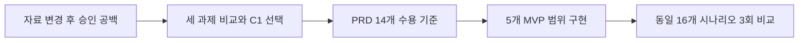

# PM 포트폴리오 추가 콘텐츠 — 3페이지 구성안

기존 포트폴리오 PDF에 추가할 **콘텐츠·배치 설계**다. PDF 원본은 제공받지 않아 편집·렌더하지 않았다. 공개 전 [PUBLICATION_REVIEW](RELEASE_REVIEW_PUBLIC.md#공개-범위와-개인정보) 확인이 필요하다. 아래 3페이지를 권장하며 2페이지로 줄이는 방법도 끝에 제시한다.

공통 디자인: 기존 포트폴리오의 글꼴·크기를 우선 따르고, 페이지당 하나의 메시지와 최대 2개 시각자료만 둔다. 초기 개인 적용은 회색, C1 합성 결과는 청록, 미검증·보류는 황색으로 구분하되 색상 옆에 텍스트 라벨도 쓴다. 모든 수치에는 대상·분모·증거 수준을 붙인다.

## 1페이지 — 반복 작성 자동화에서 승인 품질 문제로

**제목:** 보고서 작성은 빨라졌지만, 바뀐 자료를 다시 검토하는 장벽은 없었다

**핵심 메시지:** 생성 속도 개선 이후에도 최종 산출물의 신뢰성을 별도 제품 문제로 정의했다.

**상단 본문:** 사업계획서·회의록을 확인하고 기존 HWP 양식에 옮기는 업무를 자료 입력→AI 초안→검토·수정→승인 저장으로 묶었다. 본인 초기 업무 적용 3건 이상에서 평균 약 60분→3분, 약 95% 단축을 경험했다. 이후 코드와 테스트를 대조하면서 새 자료와 이전 본문이 함께 승인될 수 있는 보호 공백을 확인했다.

**배치 및 권장 시각자료:**

| 영역 | 콘텐츠 | 표시 원칙 |
| --- | --- | --- |
| 상단 20% | 프로젝트 한 줄·역할·상태 | “PM 판단·검수 / Codex 분석·구현 지원”, “C1 로컬 검증·출시 보류” 명시 |
| 중앙 왼쪽 | 60분 → 3분, 약 95% | 하단에 “초기 개인 적용 3건 이상·건별 시간 원기록 없음”. C1 결과 카드와 색/제목 분리 |
| 중앙 오른쪽 | A 자료+A 본문 → B 자료+A 본문 → 승인 경계 | “코드·가상 재현에서 확인한 위험”, 실제 사고 사례 그림으로 쓰지 않음 |
| 하단 | 가상 앱 화면 또는 업무 흐름 | 기존 화면은 v0.4.15 시연으로 표시. C1 화면이라고 재라벨하지 않음 |

**하단 문구:** “문제 정의: 자료가 바뀐 뒤 이전 본문이 재검토 없이 저장 경로에 진입하지 않도록 하되, 정상 작성은 막지 않는다.”

**활용 근거:** [README](../../README.md), [제품 분석](PM_CASE_STUDY.md#2-기존-제품의-보호-공백-발견), [기존 가상 화면](../images/app-workflow.png), [기준선](EVIDENCE_SUMMARY.md). 시간 수치는 개인 경험이고 아래 페이지의 합성 KPI와 별개다.

## 2페이지 — 세 과제를 비교하고 검증 가능한 MVP로 좁히다

**제목:** C1→C3→C2: 사용자 피해와 1인 검증 부담을 함께 판단

**핵심 메시지:** 기능을 늘리는 대신 우선순위·수용 기준·측정 범위를 먼저 고정했다.

**본문:** 자료 혼재 예방(C1), 채팅 수정 차이 확인(C3), 한글 저장 복구(C2)를 비교했다. C1은 최종 내용 확정 경로에 공백이 재현됐고 실제 API 없이 핵심 보호를 검증할 수 있어 먼저 선택했다. C3은 복원 수단이 있고, C2는 COM·완료 불명·파일 보호 검증 부담이 커 후속으로 분리했다. 점수는 실제 발생 빈도가 아닌 상대 판단이다.

**권장 시각자료 1 — 우선순위 비교표:**

| 순위·과제 | 영향도 | 시급성 | 개발 부담 | 판단 한 줄 |
| --- | ---: | ---: | ---: | --- |
| 1 C1 재검수 | 5 | 4 | 3 | 재현된 승인 공백, MVP·회귀 검증 가능 |
| 2 C3 수정 차이 | 4 | 3 | 3 | 전체 수정안 비교부터 제한 가능 |
| 3 C2 저장 복구 | 5 | 3 | 5 | 영향은 크나 실환경·프로세스 검증 부담 큼 |

표 하단: “1~5 상대 평가. 참고값=2×영향도+시급성−부담, C1 11·C3/C2 8. 동점은 검증 부담으로 판단. ROI 아님.”

**권장 시각자료 2 — 문제부터 시험까지의 연결:**

**본문 옆 짧은 요구 예시:** “자료 B로 바뀌면 본문은 보존하고 재검수를 요구한다. 부분 수정·복원·지연 응답으로 검토가 해제되지 않는다. 파일명·폴더만 바뀌면 검토를 유지한다.”

**활용 근거:** [우선순위 비교](PM_CASE_STUDY.md#3-세-개선-과제의-우선순위-결정), [결정 기록](PM_CASE_STUDY.md#3-세-개선-과제의-우선순위-결정), [PRD](PM_CASE_STUDY.md#4-prd와-14개-수용-기준), [지표](PM_CASE_STUDY.md#5-kpi와-합성-기준선-설계), [구현](EVIDENCE_SUMMARY.md). 5개 범위는 자료 식별·변경 표시·명시 검토·복원/비동기 일치·승인 보호다. 스쿼드 리딩이나 독립 전체 코딩 사례로 표현하지 않는다.

## 3페이지 — 합성 목표 달성 이후에도 출시 게이트를 남기다

**제목:** 미검토 저장 진입 18/18→0/18, 실제 HWP 검증 전 출시는 보류

**핵심 메시지:** 위험 차단과 정상 흐름 보존을 동시에 확인하고, 검증하지 않은 범위는 출시 조건으로 남겼다.

**권장 시각자료 1 — 전후 결과표:**

| 검증 항목 | 개선 전 | 개선 후 |
| --- | ---: | ---: |
| 미검토 저장 진입 | 18/18 | **0/18** |
| 정상 저장 오차단 | 0/30 | **0/30 유지** |
| 동일 합성 16개×3회 | 18 실패·30 통과 | **48회 모두 통과** |
| 신규 수용 검사 | 미구현 | **25개 통과** |
| 기존 GUI QA | 3/4 | **4/4 통과** |

표 바로 아래: “실제 UI·승인 경계 호출, API/HWP 저장 대역. 운영 사고율·만족도·업무시간 효과 아님. 기존 단위 151개 중 147개 통과·Windows 설치 COM 4개 제외.”

**권장 시각자료 2 — 완료/미검증/결정의 3칸 카드:**

| 합성 검증 완료 | 실제 검증 미완료 | PM 결정 |
| --- | --- | --- |
| AC01~AC13, X 합성 분기, AC14 모의 범위 | AC14 실제 HWP 저장·최종 재열기·서식·기존 파일 보호, C1 실사용 검수시간 | 로컬 결과 승인, 전용 환경 전 COM 보류, C1 기능의 정식 출시·메인 병합 보류 |

**하단 본문:** 한글 저장에는 실제 프로세스와 파일 보호 확인이 필요했다. 전용 Windows 환경, 새 COM 객체와 시험 PID의 대응 확인, 외부 감시, 입력·결과 해시 대조를 출시 전 조건으로 문서화했다. 준비 체크리스트는 작성했지만 환경 생성·실제 COM 시험·C1 배포는 수행하지 않았다.

**다음 단계:** 전용 환경·승인 → 실제 HWP 검증 → 검수시간/안내 이해 관찰 → 출시 재판단. 후속 기능 순위는 C3→C2이며 실제 장애 근거가 생기면 재평가한다.

**활용 근거:** [BASELINE](EVIDENCE_SUMMARY.md), [IMPLEMENTATION](EVIDENCE_SUMMARY.md), [RELEASE_REVIEW](RELEASE_REVIEW_PUBLIC.md), [TEST_ENVIRONMENT](TEST_ENVIRONMENT_PUBLIC.md), [사례 연구](PM_CASE_STUDY.md). 원시 로그 전체를 캡처하지 말고 승인된 비내용 집계만 사용한다.

## 2페이지로 줄이는 경우

1페이지에 업무 배경·개인 적용 성과·C1 문제와 후보 비교표를 넣는다. 2페이지에 PRD→구현→48회 검증 흐름, 전후 표, 출시 보류 카드를 넣는다. 역할·개인 경험의 한계·합성 표시·AC14 미검증은 축소하지 않는다. 글자가 작아지면 버전 이력·세부 기술 설명을 GitHub 사례 연구 링크로 옮긴다.

## 제작·공개 전 체크

- [ ] 기존 PDF 원본의 페이지 크기·그리드·글꼴에 맞췄다. 이 문안의 3페이지는 렌더 완료한 PDF가 아니다.
- [ ] 화면은 가상 자료만 사용하고 버전을 정확히 표기했다. C1 시연 영상/스크린샷을 새로 촬영했다고 주장하지 않는다.
- [ ] 60→3분과 18/18→0/18의 대상·근거 수준을 각각 표시했다.
- [ ] 단위 검사 제외 4개, AC14 실제 미검증, 출시 보류가 읽을 수 있는 크기로 보인다.
- [ ] 공개 승인된 문서 URL만 사용한다. 로컬 절대 경로·원시 오류 로그·실제 기업 식별자는 넣지 않는다.
- [ ] 최종 PDF에서 잘림·행 넘침·표 가독성과 링크를 별도 검수한다.
