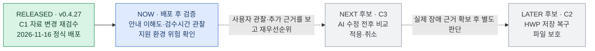

# 제품 개선 로드맵 — 공개본

2026-11-16 현행화. 원본 계획은 보존하고 실제 완료·현재 보류·향후 계획을 나누어 정리했다. 일정은 확정하지 않았으며 과거 작업일 추정을 실제 개발 소요시간으로 쓰지 않는다. **현재 main과 v0.4.27에는 C1이 포함되며 기존 v0.4.26은 보존한다.**

## 한눈에 보는 제품 로드맵

**제품 방향:** 보고서를 *빠르게 작성*하는 데서 나아가, **근거 자료와 최종 본문을 안전하게 대조·확정**할 수 있는 작성 경험을 만든다.

아래는 **출시 완료 / 현재 검증 과제 / 후속 기능 후보**를 구분한 전략·기능 통합 로드맵이다. **Next·Later는 확정 일정이나 개발 착수 약속이 아니다.**

| 구간 | 사용자 가치 | 제품 판단 | 증거·상태 |
| --- | --- | --- | --- |
| **Released · C1** | 기존 편집 보존과 미검토 승인 차단 | 오류 위험을 합성 기준선에서 재현, 현재 승인 경계부터 보호 | v0.4.27 출시 완료. 합성 18/18→0/18, 정상 오차단 0/30; 실제 배포 EXE 핵심 E2E 통과 |
| **Now · 출시 후 검증** | 재검수 절차를 이해하고 정상 업무를 지나치게 방해받지 않음 | 배포 EXE 검증 다음 단계로 실무자 관찰을 배치 | 관찰 과제·KPI 산식 정의 완료, 실제 측정 결과 확보 후 판단 예정 |
| **Next 후보 · C3** | AI 수정 결과를 쉽게 비교·선택 | 기존 복원 기능을 고려해 C1 이후 별도 기획 | 미착수. 사용자 검수 부담·복원 회귀 확인 필요 |
| **Later 후보 · C2** | 저장 중단·완료 불명 상황의 작업 보호 | 영향도는 높지만 실제 장애 빈도·안전 복구 검증 비용 불확실 | 미착수. 실제 장애 증거 및 COM 안전성 검증 필요 |

**범위 안내:** 동료의 날짜 입력 불편 피드백은 기존 제품 개선에 반영했지만, C1 정식 사용자 인터뷰·사용성 테스트나 C3/C2 효과를 검증했다는 의미는 아니다. [실제 사용자 관찰 계획](USABILITY_KPI_PLAN.md) · [출시 검증](EXE_RELEASE_REVIEW.md)

## 제품 방향과 사용자 가치

**제품 목표:** 현장점검 결과서 작성 업무에서 반복 입력 시간을 줄이는 데서 나아가, 자료·본문의 일치 여부를 확인하고 안전하게 결과서를 확정할 수 있도록 돕는다.

| 사용자 문제 | 개선 방향 | 기대 가치 | 현재 근거 수준 |
| --- | --- | --- | --- |
| 반복적인 결과서 작성 | 자료 입력→AI 초안→사람 검토·수정→승인 저장 | 작성 부담 감소 | 초기 개인 업무 3건 이상 적용, 약 60분→3분 |
| 자료 변경 후 기존 본문이 남아 잘못 승인될 위험 | C1 재검수 | 본문을 보존하면서 검토 전 확정 방지 | 코드·합성 재현 및 실제 HWP COM E2E 완료 |
| AI 수정 전후 차이를 찾기 어려움 | C3 변경 비교·적용/취소 | 수정 결과를 더 쉽게 검토 | 기대 가치, 미구현·미측정 |
| HWP 저장 중단·완료 불명 | C2 저장 복구 | 작업 중단·결과 불명 위험 완화 | 기대 가치, 미구현·장애 빈도 미측정 |

개인 업무 적용 결과와 합성 검증, 실제 COM 시험, 아직 구현하지 않은 과제의 기대 가치를 서로 다른 근거 수준으로 표시한다. 사용자 조사나 운영 통계로 일반화하지 않는다.

## 제품 전략 — 목표·지표·실행 제약

| 관점 | 방향 | 현재 판단과 근거 |
| --- | --- | --- |
| **사용자 가치** | 자료·본문을 대조하면서 편집 손실 없이 결과서를 확정 | 자료 보존·승인 차단 기능 검증 완료; 실사용 흐름은 후속 관찰 과제로 설정 |
| **업무 운영 가치** | 결과서의 잘못된 확정 위험을 줄여 검수 절차의 신뢰성을 높임 | 조직의 실제 사고율·ROI·비용 절감 수치는 없음 |
| **기능 품질 지표** | 미검토 저장 진입률과 정상 저장 오차단률을 함께 확인 | 합성 48회: 미검토 18/18→0/18, 정상 오차단 0/30 유지 |
| **출시 후 사용자 성과** | 안내 이해도·재검수 과제 완료율·활성 검수시간·만족도 | 관찰 과제와 기록 방법을 정의. 실측 결과가 수집될 때 기준선 및 다음 개선 우선순위 판단 |
| **자원·협업 제약** | 1인이 사용자 문제·범위·검수 기준을 정의하고 Codex로 구현·테스트 지원 | 실제 인력/예산 배정이나 개발 스쿼드 운영 경험으로 일반화하지 않음 |
| **기술·배포 제약** | Windows/Tkinter, 한글 COM, 기존 HWP 양식과 기존 파일 보호 | v0.4.27 핵심 배포 E2E 통과; 다중 한글 버전·NAS·기존 세션 공존·COM 강제 중단 복구 미검증 |

이 표는 **현재 프로젝트의 제품 목표와 검증 설계**를 정리한 것으로, 조직의 승인된 사업 전략이나 실측 고객 KPI를 대체하지 않는다. 상세 목표·Non-Goals는 [PRD](PRD_PUBLIC.md)에, 의사결정 원문은 [결정 기록](DECISION_LOG_PUBLIC.md)에 둔다.

## 후보와 우선순위

| 순위 | 과제 | 영향도 | 시급성 | 개발 부담 | 판단 근거 |
| --- | --- | ---: | ---: | ---: | --- |
| 1 | C1 자료 변경 후 재검수 | 5 | 4 | 3 | 최종 내용 혼재 위험, 승인 공백 재현, UI 상태·회귀 중심으로 제한 가능 |
| 2 | C3 채팅 수정 차이 확인 | 4 | 3 | 3 | 의도 밖 변경을 찾는 검수 부담, 기존 복원으로 일부 회복 가능 |
| 3 | C2 한글 저장 복구 | 5 | 3 | 5 | 핵심 작업 중단 위험, 실제 빈도 미확인, 프로세스·파일 게시 실환경 부담 |

1~5 상대 평가다. 영향도는 문제 발생 시 피해, 시급성은 확인한 증거와 우회 수단, 부담은 구현부터 회귀·실환경 검증까지다. 참고 산식 2×영향도+시급성−부담은 C1 11, C3/C2 8이며 ROI가 아니다. 동점에서는 1인 검증 부담을 우선했다. 실제 반복 피해가 없어 시급성 5는 부여하지 않았다.

초기 C1→C2→C3 제안을 재검토해 **C1→C3→C2**로 결정했다. 실제 저장 중단이나 수정 손실의 반복 증거가 생기면 순위를 재평가한다. [결정 기록](DECISION_LOG_PUBLIC.md)

## 실행 로드맵: Released / Now / Next / Later

| 구간 | 과제 | 사용자 가치 | 완료 조건 | 상태·의존성 |
| --- | --- | --- | --- | --- |
| **RELEASED** | C1 자료 변경 재검수 | 자료 변경 후 미검토 확정 방지 | 소스·실제 EXE 핵심 검증 후 동일 ZIP 게시·해시 검증 | 2026-11-16 main 병합·v0.4.27 정식 배포 완료 |
| **NOW** | 출시 후 사용자·환경 검증 | 안내 이해·검수 부담·지원 환경 위험 파악 | 합성 자료로 실무자 과제 관찰, 환경별 성공·실패 기록 | 관찰·지원 환경 시험 계획 수립. 실측·추가 환경 결과는 확보 후 업데이트 |
| **NEXT** | C3 수정 차이 확인 | AI가 바꾼 부분을 검토하고 필요한 변경만 적용 | 전후 차이 표시, 적용·취소 동작, C1 검토·복원 회귀 검증 | 미착수. 별도 PRD와 범위 확정 필요 |
| **LATER** | C2 한글 저장 복구 | 저장 중단·완료 불명 상황에서 작업 보호 | 실제 장애 유형·빈도 조사, 안전한 복구·재시도 조건과 파일 보호 검증 | 미착수. 실제 반복 장애와 전용 검증 환경이 선행 조건 |

위 RELEASED의 2026-11-16은 실제 완료일이다. NOW/NEXT/LATER는 확정 일정이나 출시 약속이 아니라 우선순위 방향이다. 사용자 관찰과 지원 환경 검증은 정식 배포 완료와 별도로 남아 있다.

## 의존성·리스크·재우선순위 조건

| 구분 | 위험 또는 의존성 | 대응·판단 게이트 |
| --- | --- | --- |
| **사용성 / Now** | 재검수 안내를 이해하지 못하거나 승인 준비에 시간이 더 걸릴 수 있음 | 실제 과제에서 안내 인지·활성 검수시간·완료 여부 관찰. 혼동 반복 시 UX 문구·동선부터 검토 |
| **C3 / Next 후보** | 수정 차이·적용/취소 기능이 C1의 검토 상태·기존 복원 동작을 훼손할 수 있음 | 별도 PRD·화면 설계·복원 회귀 테스트 정의 후 개발 여부 결정 |
| **C2 / Later 후보** | COM 멈춤·저장 실패에서 무리한 재시도는 파일 손상·중복 저장을 유발할 수 있음 | 실제 장애 유형·빈도와 독립 시험 환경 확보, 기존 파일·세션 보호 조건 먼저 확정 |
| **배포 환경 / Now** | 기존 한글 세션 공존·다중 버전·NAS·강제 COM 중단 복구는 아직 검증되지 않음 | 지원 환경별 위험과 시험 결과를 별도로 기록하고 무검증 범위를 명시 |
| **자원 제약 / 전체** | 1인 운영과 AI 구현 보조만으로 여러 대형 기능을 동시에 진행하기 어려움 | 검증 가능한 MVP로 분리하고, 추가 기능은 근거·우선순위 재평가 후 결정 |

**우선순위 변경 트리거:** 재검수의 실제 시간 부담이 크면 UX 개선 또는 C3를 앞당길지 검토한다. 저장 실패가 반복되고 작업 손실 위험이 확인되면 C2의 순위를 다시 평가한다. 이는 **미래의 조건부 판단 규칙**이며 실제 그런 사고가 관측됐다는 뜻이 아니다.

## 완료한 단계

| 단계 | 실제 수행 | 확인한 결과 |
| --- | --- | --- |
| 업무/MVP | 자료 입력→초안→검토·수정→승인 HWP 저장 정의 | 초기 개인 업무 3건 이상 적용. 시간 성과는 개인 경험으로 별도 표시 |
| 제품 분석 | 코드·기존 테스트·QA·벤치마크와 보호 경계 분석 | 자료 변경 후 이전 본문이 승인 경로에 도달하는 가상 재현 |
| C1 명세 | MVP 5범위·AC01~14·X8·분모/산식 정의 | [공개 PRD](PRD_PUBLIC.md) |
| 기준선 | 합성 U6/N10×3회 고정 | 미검토18/18, 정상 오차단0/30 |
| 로컬 구현·검증 | 자료 식별·재검수·명시 검토·복원/비동기·승인 보호 | 미검토0/18·오차단0/30, 수용26·GUI4·기존151 통과 |
| 실제 COM E2E·품질 완료 | HWP4개 저장·Open·동명 보호·60문단, 전체7쪽 검수 | [최종 판정](QUALITY_REVIEW.md). 사용자 파일 접근 승인 참여 |
| 공개 문서·실제 화면 | 개인정보 없는 요약과 실제 C1 창 캡처 | [시연](C1_DEMO.md). 실제 API/COM/저장 없음 |

## 출시 후 검증과 후속 실행 기준

| 순서 | 판단·검증 과제 | 완료 기준과 상태 |
| --- | --- | --- |
| **NOW / C1** | 배포 후 사용자 관찰·지원 환경 추가 검증 | 소스·실제 EXE 검증·정식 배포 완료. 상용 환경 전반·기존 사용자 세션 공존은 **미검증** |
| **NOW / 사용자 관찰** | 재검수 안내 이해·활성 검수시간 | [사용자 테스트 계획](USABILITY_KPI_PLAN.md)의 과제·산식에 따라 관찰 후 결과를 기록하는 단계 |
| **NEXT / C3** | 수정 차이 표시·적용/취소 | 별도 PRD·프로토타입·C1 복원 회귀 기준 확정 후 개발. **미착수** |
| **LATER / C2** | 저장 실패·완료 불명·복구 위험 조사 | 장애 빈도와 파일·프로세스 보호 실환경 증거 확보 후 범위 확정. **미착수** |

C1 기능 검증 이후 2026-11-16 별도 실제 EXE 게이트를 통과해 **v0.4.27 정식 출시를 완료**했다. [배포 근거](EXE_RELEASE_REVIEW.md) 향후 실제 수정 손실·저장 장애·사용자 검수 부담의 근거가 확보되면 영향도·시급성·개발 부담을 다시 평가한다.

**보조 산출물:** [사용자 여정·인터뷰 설계](USER_RESEARCH_JOURNEY.md), [UX·Figma 제작 명세](UX_PROTOTYPE_SPEC.md), [요구사항 백로그](PRODUCT_BACKLOG.md), [사용성·KPI 계획](USABILITY_KPI_PLAN.md). 이 문서는 실제 인터뷰·Figma 파일 제작·사용자 테스트 완료를 의미하지 않는다.

새 서버·자동 사실 판정·세션 디스크 복구·문장별 병합·자동 재시도를 C1에 끼워 넣지 않는다. 문서 게시나 실제 UI 캡처 완료를 기능 출시로 계산하지 않는다.

[사례 연구](PM_CASE_STUDY.md) · [검증 집계](EVIDENCE_SUMMARY.md) · [출시 검토](RELEASE_REVIEW_PUBLIC.md) · [환경 준비](TEST_ENVIRONMENT_PUBLIC.md)
