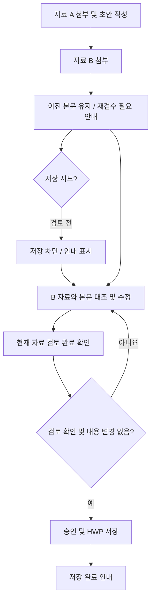

# C1 UX 화면·Figma 프로토타입 명세 — 공개본

> **상태:** 기존 Tkinter C1 화면과 PRD를 기반으로 만든 **향후 Figma 제작용 명세**. 실제 구현 화면을 기준으로 프레임·상태·상호작용을 정리했다. Figma 제작은 후속 작업이며, 구현된 C1 화면은 [6단계 시연](C1_DEMO.md)에서 확인할 수 있다.

## 1. 사용자 목표

사용자가 A 자료를 B 자료로 변경해도 편집 내용을 잃지 않고, 검토하지 않은 결과서는 저장되지 않으며, 무엇을 해야 정상 저장되는지 이해할 수 있어야 한다.

## 2. 화면 흐름

## 3. Figma 프레임 사양 (제작 예정)

| 프레임 | 주요 요소 | 상호작용 | 상태 |
| --- | --- | --- | --- |
| F01 현재 A 초안 | 좌측 자료·회의록, 우측 본문, 검토 상태 | B 첨부 선택 | 실제 UI 구현·Figma 전환 예정 |
| F02 B 자료 변경 | B 자료·A 본문 보존, 재검수 안내 | '승인 및 한글 저장' | 실제 UI 구현·Figma 전환 예정 |
| F03 미검토 차단 | '자료 재검수 필요' 대화, 기존 입력 유지 | 대화 닫기 → 본문 수정 | 실제 UI 구현·Figma 전환 예정 |
| F04 B 본문 수정 | 내용 수정, 검토 필요 상태 유지 | 검토 완료 버튼 | 실제 UI 구현·Figma 전환 예정 |
| F05 명시 검토 확인 | 현재 자료·본문·일반현황 대조 질문 | 취소/확인 | 실제 UI 구현·Figma 전환 예정 |
| F06 검토 완료 | 검토 완료 상태, 저장 버튼 | 저장 → 성공 또는 오류 안내 | 실제 검토 화면 존재; 저장 별도 E2E 근거 |

## 4. 상태 및 카피 검토

- **검토 필요:** '자료가 변경되어 기존 초안 재검수가 필요합니다.' — 이유와 다음 행동을 함께 안내.
- **검토 완료:** 현재 자료 기준으로 대조했음을 표시. 새 내용 변경 시 다시 검토 필요.
- **저장 차단:** 수정 내용을 보존하고 저장 함수 호출은 하지 않음.
- **저장 성공/실패:** 성공 표시와 파일 열기 버튼은 현재 저장 시도 결과에 일치해야 함.
- **접근성 검토 예정:** 경고 의미를 색상에만 의존하지 않도록 텍스트를 병기하고 키보드 포커스·대화상자 순서를 확인.

## 5. Figma에서 만들 때의 연결 규칙

1. F01~F06을 같은 화면 크기의 프레임으로 만들고 실제 캡처의 요소 순서를 참고한다.
2. 클릭 가능한 연결은 B 변경→검토 필요→차단→수정→명시 검토→완료 순서로 만든다.
3. 취소·이전·실패 경로도 연결하되, 실제 구현하지 않은 기능은 시안으로만 표시한다.
4. 사용자 테스트에는 업무 원본이 아닌 합성 예시를 사용한다.
5. 완료 후 실제 **Figma URL, 제작일, 프로토타입 테스트 결과**를 기록한다.

**현재 산출물:** C1 실제 프로그램 UI·E2E 근거·Figma 제작 명세 · **후속 산출물:** Figma 프로토타입과 테스트 결과

[PRD](PRD_PUBLIC.md) · [실제 화면](C1_DEMO.md) · [사용자 여정](USER_RESEARCH_JOURNEY.md) · [사용성 테스트 계획](USABILITY_KPI_PLAN.md)
